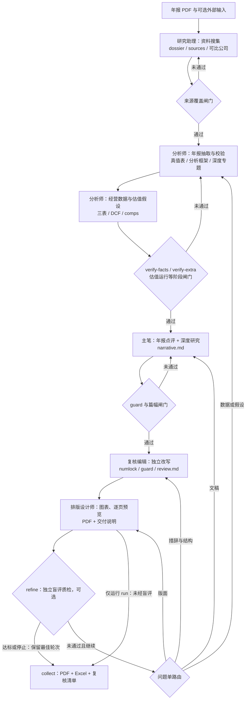
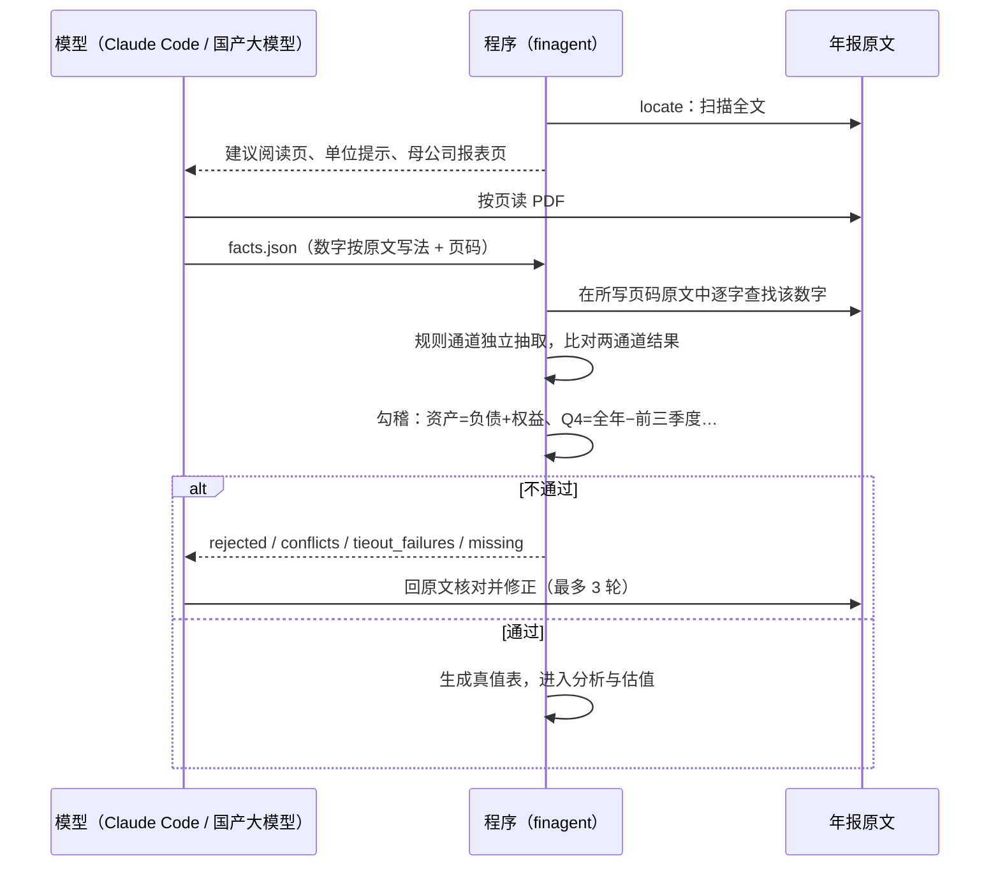
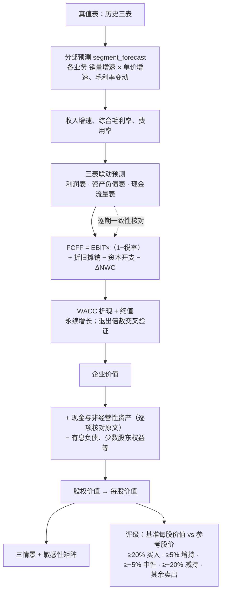
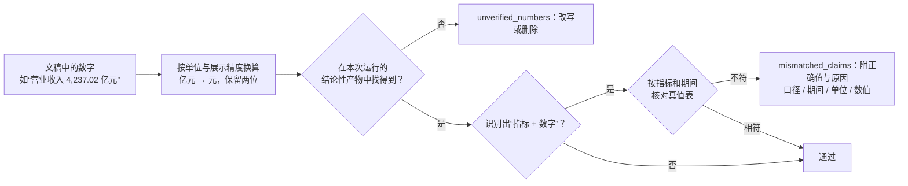
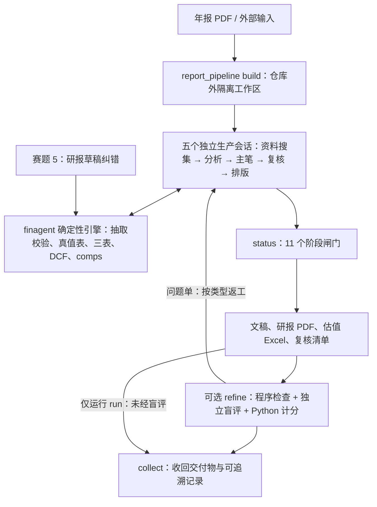

# FinAgent：可追溯的金融投研智能体

> 2026 北京市大学生金融人工智能竞赛（主题：金融投研智能体构建）参赛作品 · 产品需求文档（PRD）

以 A 股年报为核心输入（可附季报、研报草稿，并登记年报之后的外部资料），项目分别完成财报分析、估值建模与研报纠错。
研报流水线在隔离工作区内，由**研究助理、分析师、主笔、复核编辑、排版设计师**五个独立会话依次生产深度研报 PDF
和估值模型 Excel；可选的 `refine` 循环再引入独立盲评会话质检。历史财务数字核对年报原文，外部事实登记来源，
预测参数标明假设；增速、勾稽和估值由确定性代码计算，不让模型心算。

| 选题 | 模块 | 核心产出 |
|---|---|---|
| 2 上市公司财务报告分析 | `finagent/tasks/financials/` | 指标表（附页码）、同比/环比、单季拆分与分季度勾稽、勾稽校验、异常信号、利润变动归因、实际 vs 一致预期/业绩预告、EPS 质量 |
| 4 自动化估值建模 | `finagent/tasks/valuation/` | 分部量价预测 → 三表联动 → 三情景 DCF（FCFF）+ 敏感性、可比公司估值、情景偏度、`model.xlsx` |
| 5 研究报告纠错核查 | `finagent/tasks/report_check/` | 逐条断言核查：正确 / 数值 / 单位 / 期间 / 口径 / 方向错误 / 无法核实，附来源与修改建议 |

---

## 1. 背景与问题

用大模型直接“读年报写研报”，有三个无法接受的问题：

| 问题 | 表现 | 对投研的后果 |
|---|---|---|
| **数字幻觉** | 模型编造或记错财务数字，心算增速、占比时出错 | 一个错数就会让整篇报告失去可信度 |
| **不可追溯** | 看不出数字来自年报哪一页、是合并还是母公司口径 | 评审和读者无法核对，无法复现 |
| **计算不可靠** | 让模型做 DCF、三表勾稽，结果随机、口径漂移 | 估值结论不可复现，也无法做敏感性分析 |

人工投研则慢：一份年报点评加估值模型，分析师需要数天完成抽数、建模、写作和排版。

## 2. 产品目标

**目标**

1. **准**：历史财务数字定位并校验到年报；外部事实登记来源；预测数字区分为分析师假设和程序推导值，并对正文运行数字护栏。
2. **可追溯、可复现**：保存来源、假设、运行产物、文件哈希和会话事件流。已保存输入上的程序计算可复算；重新生成模型文稿或重新盲评仍需相应模型及环境，不能宣称离线无模型复现全部结果。
3. **专业**：交付物达到卖方研报与投行模型的体例：事实、推论、观点分开，估值写明假设、适用范围与风险。
4. **可质检**：阶段闸门先检查输入和产物，独立评审再给出逐条证据与问题单；未达标时按问题类型返工并保留最佳轮次。

**非目标**

- 不做比赛选题 1、3、6、7。
- 不做 OCR：扫描页直接拒收。
- 不给出个性化投资建议：评级由程序按固定规则从估值结果得出，报告附免责声明。

## 3. 用户与场景

| 用户 | 场景 | 用到的功能 |
|---|---|---|
| 行业研究员 | 基于年报和后续资料做年报点评暨深度研究 | 资料搜集 → 财报分析 → 估值 → 写作/复核 → 研报 PDF |
| 估值建模分析师 | 需要一个能改假设、能复算的模型 | `model.xlsx`（输入蓝、公式黑，情景切换）、敏感性矩阵 |
| 研报审核 / 质检员 | 对照来源、估值模型和评分证据复核报告 | 数字护栏、盲评问题单、逐项人工质检页 |
| 比赛评审 | 复算程序结果、检查来源与生成过程 | `runs/<run_id>/`、工作区 `.pipeline/`、`eval/results/`；Agent 版本可用 `--llm replay` |

## 4. 产品形态

计算引擎只有一套。下表的 **Agent 版本 / Skill 版本** 是两种读文档与调用引擎的方式；它们不是研报流水线的五个分工角色。

| | Agent 版本 | Skill 版本 |
|---|---|---|
| 读年报 / 研报 | pdfplumber 解析 + 规则通道为主，国产大模型（DeepSeek / 千问 / 智谱）补漏 | Claude Code 中的模型按页读 PDF 抽取，规则通道交叉校验 |
| 调度 | `python -m finagent all`（流水线）或 `ask`（程序内 Agent 循环） | `report_pipeline` 建隔离工作区并调度独立会话；分别使用 `finagent-research`、`finagent-report`、`finagent-review` Skill |
| 大模型接入 | OpenAI 兼容 API，`.env` 配置；响应缓存于 `.cache/llm/` 供 `replay` 复现 | Claude Code 自身；抽取结果存 `data/extractions/` 供复现 |
| 研报 PDF | 不提供同一套多会话深度研报流程 | 支持（`reportkit` 排版；当前流水线的 PDF 闸门为 25～32 页、至少 60 个图表） |
| 季报 | 暂不支持 | 支持（`--supplement`） |

两个版本在已有样例的共用计算结果上逐项一致（`tests/test_skill.py`）；这不等于两种生成流程或真实研报质量相同。

**交付物**

| 交付物 | 内容 |
|---|---|
| 研报 PDF（红色主题） | 年报点评 + 深度研究、盈利预测与估值、风险及附录；当前流水线要求正文不少于 15,000 字、深度研究至少占 60%，PDF 25～32 页并含至少 60 个图表。篇幅闸门不等于分析质量认证 |
| 估值模型 Excel | 运行产物为 `model.xlsx`，`collect` 收回交付目录时命名为 `sheet.xlsx`；含估值汇总、DCF、WACC、敏感性、三表模型、分部预测、历史财务、分季度及经营数据 |
| 分析产物 | `financials/report.md`、`analysis.json`、`earnings.json`；`valuation/*.json`；`check/report.md`、`findings.csv` |
| 研报工作区 | `research/dossier.md`、`sources.json`、`research/topics/`、`report/framework.md`、`narrative.md`、`review.md`、`delivery.md`；按阶段闸门检查 |
| 追踪与质检 | `runs/<run_id>/` 的追踪/清单、工作区 `.pipeline/agents/*.jsonl` 与 `agent_runs.json`；`refine` 的轮次、盲评结果与问题单存于仓库外的评测目录 |

---

## 5. 端到端流程

### 5.1 总体流程

新公司研报按“**先搜集、后分析，再独立复核与排版**”运行。下图是 Skill 版深度研报流水线；赛题 5 的研报纠错任务
可以单独运行，不是这条生产链中一个必经的写作会话。



`report_pipeline` 是确定性的 Python 编排器，不是第六个写作模型。`run` 依次启动五个互不继承上下文的会话，
只通过工作区文件交接；`status` 核对各阶段闸门，前序文件变化会使下游结果过期。`refine` 在完成生产闸门后
另起盲评会话，评分标准和完整评审结果保存在工作区之外，生成方只接收有理由和证据的问题单。

### 5.2 抽取与校验：谁做什么

模型只负责“读”和“写”，程序负责“核”和“算”。



### 5.3 估值：分部预测驱动三表，三表驱动 DCF



没有量价数据的行业（如航运），可以不写分部预测，直接给出合并收入增速与毛利率路径，并在分析框架里说明原因。

### 5.4 研报生成

| 会话 | 阶段 | 主要交接物与闸门 |
|---|---|---|
| 研究助理（默认 Opus） | 1 资料搜集 | 先查年报之后的业绩、股价、预期、可比公司、行业、竞争和近期事件；形成 `research/dossier.md` 与 `sources.json`。校验类别覆盖、检索量和近期来源 |
| 分析师（默认 Opus） | 2～7 财务抽取、分析框架、深度调研、经营数据、估值假设、估值运行 | 年报事实逐字定位；至少 3 个深度专题各有独立笔记；预测假设引用资料来源并与最新业绩衔接；`verify-facts`、`verify-extra` 和估值运行通过 |
| 主笔（默认 Opus） | 8 文稿 | 基于资料包、专题笔记与模型写“年报点评 + 深度研究”；正文通过 `guard`，并满足字数与深度研究占比闸门 |
| 复核编辑（默认 Sonnet） | 9 复核改写 | 独立读稿、写修改记录与 `review.md`，只改文字不擅改数字；`numlock` 和重新执行的 `guard` 通过 |
| 排版设计师（默认 Opus） | 10～11 排版、交付说明 | 定制图表和版式，打印 PDF、逐页检查预览；核对 PDF 新鲜度、页数与图表数，写 `delivery.md` |

分析框架**不预设行业模板**：模型结合年报与资料包，推导公司的收入和利润驱动、领先指标及预测参数。
外部事实须先登记来源再引用；模型起草的估值参数必须注明假设。实际阶段定义和阈值以 `finagent/report_pipeline.py`
生成的工作区 `AGENTS.md` 与 `status` 为准。

`refine` 的盲评采用 `eval/rubrics/report_v1.json`（v0 仍保留用于复现历史结果）：L0 硬闸门、L1 数据闭合由程序检查；
L2 分析质量、L3 表达与合规及负向条目由独立评审会话判定，Python 计分。未达标时，数据/假设问题回分析侧，
措辞/结构问题回复核侧，版面问题回排版侧；达到标准、满轮数或连续两轮提升不足时停止，保留得分最佳轮次，
未解决问题进入人工复核清单。详见 [评分标准](eval/rubrics/README.md)和[设计说明](docs/design/2026-10-03-multi-agent-eval.md)。

---

## 6. 功能需求

### 6.1 财报分析（赛题 2）

| 编号 | 需求 | 实现 |
|---|---|---|
| F2.1 | 抽取合并报表核心指标，附来源 `{文件, 页码, chunk, 行, 列}` | `extract.py`；Skill 版本 `verify-facts` |
| F2.2 | 同比、环比；季报单季拆分：Q2=H1−Q1、Q3=前三季度−H1、Q4=全年−前三季度 | `analyze.py` |
| F2.3 | 勾稽校验：资产负债表平衡、单季合计=全年等 | `analyze.py` |
| F2.4 | 异常信号：非经常性损益占比、利润与现金流背离、存货/应收增速高于收入、会计口径变化 | `analyze.py` |
| F2.5 | 利润变动归因桥；实际 vs 一致预期 / 业绩预告；EPS 质量 | `earnings.py` |
| F2.6 | 经营数据（分产品、区域、产销量、产能、分红）逐格核对，派生比率由程序计算 | `extras.py`、`verify-extra` |

### 6.2 估值建模（赛题 4）

| 编号 | 需求 | 实现 |
|---|---|---|
| F4.1 | 分部量价预测，单位可配置（吨、GWh…） | `segment_forecast.py` |
| F4.2 | 三表联动预测，逐期勾稽 | `three_statement.py`、`ts_engine.py` |
| F4.3 | FCFF DCF，三情景，WACC / 永续增长 / 退出倍数 | `dcf.py`、`build_plan.py` |
| F4.4 | 企业价值到股权价值的逐项估值桥，非经营性资产逐项核对原文 | `build_plan.py` |
| F4.5 | 多维敏感性、情景偏度 | `run.py`、`scenarios.py`、`scenario_tables.py` |
| F4.6 | 可比公司估值与利润率对比，与 DCF 交叉验证 | `comps.py` |
| F4.7 | 投行排版 Excel：输入蓝、公式黑、跨表绿，关键计算为公式 | `workbook.py`、`workbook_ts.py`、`output/xlsx.py` |

### 6.3 研报纠错（赛题 5）

| 编号 | 需求 | 实现 |
|---|---|---|
| F5.1 | 从研报中拆出可核验的数字断言 | `claims.py` |
| F5.2 | 与真值表逐条比对；容差按研报展示精度（半个末位） | `verify.py` |
| F5.3 | 错误分类：数值 / 单位 / 期间 / 口径 / 方向；只有找到精确匹配才下结论 | `verify.py` |
| F5.4 | 预测性表述、缺少真值的断言判“无法核实”，不计为错误 | `verify.py` |

### 6.4 研报生成

| 编号 | 需求 | 实现 |
|---|---|---|
| FR.1 | 动笔前形成资料包和至少 3 个深度专题；正文采用年报点评 + 深度研究结构，关键预测参数写明依据数字、换算与取值 | `report_pipeline.py` 阶段 1、3～4、8；`finagent-report` Skill |
| FR.2 | 正文至少 15,000 字，深度研究至少占 60%；PDF 闸门为 25～32 页、至少 60 个图表（目标约 25～30 页） | `report_pipeline.py` 的 `status`；`reportkit/layout.py`、`charts.py`、`tables.py` |
| FR.3 | 统一红色主题；正文 Times New Roman + 楷体，表格与图表数字用 Helvetica | `reportkit/core.py`、`report.css` |
| FR.4 | 外部信息先登记来源；正文通过 guard；复核改写经过数字锁；评级取程序结果并附免责声明 | `output/sources.py`、`guard.py`、`numlock.py`、`reportkit/disclaimer.md` |
| FR.5 | 独立盲评逐条给出证据；问题单分类路由返工，保留最佳轮次 | `finagent/evaluation/`、`report_pipeline refine` |

---

## 7. 设计思路

### 7.1 六条设计原则

1. **LLM 不做算术。** LLM 负责理解文本、抽取补漏、写文字解读和做任务规划；同比、占比、估值、勾稽全部由确定性 Python 完成。连“约三倍”“超过四成”这类心算约数也不允许。
2. **分清数字来源。** 年报抽取结果带原文定位；外部事实登记到 `sources.json`；预测参数标为假设，并让派生数回到计算产物。LLM 抽出的年报数字必须能在原文 chunk 中找到，否则丢弃。
3. **双通道不静默取舍。** 规则通道和 LLM 通道一致时记为 `rule+llm`；不一致时记为问题交人工复核，不偷偷选一个。
4. **一张真值表。** `analyze()` 产出的 `truth_table` 是估值和纠错的唯一数据来源。抽取有拒收、冲突、核心缺失或勾稽失败时，流水线在估值前停止。
5. **误报控制优先于召回。** 纠错容差按展示精度计算；错误类型必须找到精确匹配才下结论。
6. **可追溯、分层复现。** 计算流水线记录文件读取、产物与哈希；程序内 Agent 的 LLM 响应按请求哈希缓存，可用 `--llm replay` 复现已缓存的请求。研报多会话流程另存事件流和交接文件；重新写作与盲评仍需要模型环境。

### 7.2 数字护栏

研报文稿在进入 PDF 前运行 `guard`，核对其中可识别的数字与本次运行产物；它不能代替对外部资料、预测假设和分析判断的人工复核：



研报草稿里的数字不算出处。独立复核会话改写前后必须过“数字锁”，防止数字被无意增删或改动；
需要补数据或改假设的问题要回到分析与计算阶段，不能在编辑阶段凭空加数字。

### 7.3 报告的措辞分层

| 层次 | 措辞 | 例 |
|---|---|---|
| 事实 | 直接陈述，数字来自真值表 | 营业收入 281.77 亿元，同比增长 9.22% |
| 推论 | “主要系”“反映” | 扣非增速低于归母，主要系卖船收益计入非经常性损益 |
| 观点 | “我们认为”“我们预计” | 我们预计运价 2026 年见顶后回到周期中枢 |

估值参数、股价等年报之外的输入，都在出现处注明“假设”或数据来源。

### 7.4 单位约定

- 财务事实内部统一用**元**；估值模块（DCF、三表、comps）用**百万元**，每股用**元**。
- 比率存百分数值（14.49 表示 14.49%）。
- 同一页有多个“单位：”声明时，每张表按其上方最近的声明解析。

---

## 8. 系统架构



`report_pipeline` 管理会话与阶段状态；`finagent/tasks/` 提供共用计算；`finagent/evaluation/` 只做质检，
其 Rubric 和完整评分不复制进生成工作区。`run` 是顺序生产，`refine` 才加入盲评与多轮返工；两者不能混称为
“已经质检达标”。人工质检 Demo 只是查看和收集反馈的界面，不会自动改写正式评分。

### 目录

```
finagent/
  core/          config · llm（OpenAI 兼容客户端 + 缓存）· tracing（追踪）· tools（Tool 注册）
                 orchestrator（Pipeline + Agent 循环）· numbers（中文单位 / 精度）
  parsing/       document（PDF/MD → 带页码锚点的 Chunk）· locate（关键页定位）
  tasks/
    financials/  schema（A 股指标字典）· extract（规则 + LLM + 证据校验）· analyze（计算 / 勾稽 / 信号）
                 earnings（归因桥、预期 / 预告对比、EPS 质量）· extras（经营数据与派生比率）
    valuation/   segment_forecast（分部量价）· three_statement + ts_engine（三表联动）· build_plan · dcf
                 run（执行 / 敏感性 / xlsx）· scenarios + scenario_tables · comps · forecast_summary（盈利预测与评级）
                 workbook + workbook_ts（Excel 模型）
    report_check/ claims（断言抽取）· verify（核查与错误诊断）
  output/        report（事实｜推论｜观点）· xlsx（Excel 写出与样式）· guard（数字护栏）
                 sources（外部来源校验）· numlock（复核数字锁）
  prompts/       Prompt 模板
  pipelines.py   流水线与 Agent 工具注册
  report_pipeline.py  build / run / status / refine / collect / scorecard
  evaluation/    程序检查、盲评、Rubric 计分、问题单与质检查看包
  doctor.py      环境自检
.claude/skills/
  finagent-pipeline/  隔离工作区和测评的入口
  finagent-research/  抽取、校验、估值与纠错规范
  finagent-report/    调研、写作、排版规范；reportkit 与模板/定制脚本样例
  finagent-review/    独立复核、改写与数字锁规范
.agents/skills/        Codex 等工具的 Skill 入口（由 sync-skills 生成）
data/
  samples/       样例：虚构公司年报、季报、估值假设、同业、一致预期、业绩预告、植入错误的研报草稿
  extractions/   各公司收回的抽取文件、经营数据、估值假设、调研、文稿与编排脚本
report/
  resources/     年报与其他输入原件及 SHA-256 清单
  交付/          研报 PDF、sheet.xlsx 与复核清单
eval/            样例金标准；rubrics/ 为 v1 默认标准，results/ 为质检结果，review_pack/ 为查看包与质检 Demo
scripts/         macOS/Linux 与 Windows 环境准备脚本
tests/           pytest；golden/ 为原插件引擎的产出快照（见 THIRD_PARTY.md）
```

工作区默认在 `~/finagent-samples/`，评测目录默认在 `~/finagent-evals/`，均应位于仓库目录树之外。

---

## 9. 质量保证

| 手段 | 内容 | 当前结果 |
|---|---|---|
| 单元与集成测试 | `python -m pytest -q tests`：流水线、Skill 与 Agent 一致性、季报拆分、三表、研报排版、质检与阶段闸门 | 以当前命令输出为准；2026-10-04 本地 Python 3.12 实测 124 通过、5 跳过 |
| 评测 | `eval/run_eval.py`：字段抽取准确率，纠错召回率、准确率、误报数、错误类型准确率 | 样例上抽取 100%（35/35），纠错召回率与准确率均 100%，误报 0 |
| 引擎一致性 | `test_golden.py` 对比原插件引擎快照，必须完全相等；`test_parity_reference.py` 随机输入逐项对照 | 通过 |
| 真实交付物 | 年报、抽取、模型和研报按公司保留；`status` 检查阶段闸门，独立质检输出逐项证据与问题单 | 见 `report/交付/` 与 `eval/results/`，不能用测试样例指标替代真实研报质量 |

样例数据是自造且内部完全自洽的，真实年报上的效果会明显低于样例指标。

### 真实公司案例

早期三家公司报告使用旧写作流程，以下估值是当时假设下的结果，不代表当前股价或最新模型结论：

| 公司 | 研报 | 基准每股价值 | 参考股价 | 程序评级 | 主线 |
|---|---|---:|---:|---|---|
| 贵州茅台 600519 | 21 页 | 1,531.40 元 | 1,237.00 元 | 买入 | 量价与渠道结构、直销占比 |
| 宁德时代 300750 | 21 页 · 62 个图表 | 383.31 元 | 291.11 元 | 买入 | 以量补价：GWh 出货、储能占比、海外收入；存货高增风险 |
| 招商轮船 601872 | 19 页 · 48 个图表 | 7.51 元 | 20.15 元 | 卖出 | 油轮贡献主要利润；运价周期见顶假设；在手订单与杠杆上升 |

估值参数均为起草的假设，股价为外部数据，结论高度依赖假设，不构成投资建议。
宁德时代和招商轮船的 Opus 交付 PDF 与模型保存在 `report/交付/`；它们使用统一的红色研报主题。

新流水线还生成了中际旭创、宇树科技两份约 30 页的深度研究，交付文件和模型在 `report/交付/`。
其已封存质检结果分别为 90 分、88 分（`eval/results/v2_*/score.json`，**按当时的 v0 Rubric**），
不能与今后默认 v1 Rubric 的新评分直接比较；已有分数也不能证明 `refine` 多轮循环已在所有公司完整跑通。
评分标准 v1 依据三家 v0 报告的人工质检调整了外部引用、复核清单和表达条目，版本差异见
[Rubric 说明](eval/rubrics/README.md)。

---

## 10. 快速开始

在仓库根目录操作。建议 Python 3.12；深度研报还需要 Node.js 18+、已登录的 Claude Code、Chrome/Chromium/Edge 与中文字体。
环境准备脚本会创建 `.venv`、安装依赖、检查上述组件，并在 `.env` 不存在时从示例复制；不会替你填写密钥。

macOS / Linux：

```bash
bash scripts/setup.sh
```

Windows PowerShell：

```powershell
powershell -ExecutionPolicy Bypass -File scripts\setup.ps1
```

脚本发现未安装 Claude Code 时只给出安装提示；可先按提示安装并运行 `claude auth login`，或按 `.env.example` 配置 API。
手动复查环境用：

```bash
python -m finagent.doctor
```

`doctor --live` 会对生成与质检模型各发一次最小请求，可能计费；普通自检不调用模型。以下命令假定已激活 `.venv`、
`python` 指向该环境；否则 macOS/Linux 用 `.venv/bin/python`，Windows 用 `.\.venv\Scripts\python.exe` 替换。
研报打印找不到浏览器时可设置 `FINAGENT_CHROME`，中文字体找不到时检查本机字体安装。

### 样例一键运行（无需 API Key）

```bash
python -m finagent all --input data/samples/annual_report_2024.md --year 2024 --company 星河智造 --assumptions data/samples/valuation_assumptions.json --report data/samples/research_draft.md --peers data/samples/peers.csv --estimates data/samples/estimates.csv --guidance data/samples/guidance.csv --llm off
```

只走规则通道，不运行五会话研报流程。`--peers`、`--estimates`、`--guidance` 可选；产物在 `runs/<run_id>/`。
分任务运行：`python -m finagent financials|valuation|check ...`。

### 复算仓库中的真实公司估值（无需模型）

```bash
python -m finagent valuation --input "report/resources/宁德时代/300750_宁德时代_2025_年度报告.pdf" --year 2025 --company 宁德时代 --assumptions data/extractions/宁德时代_2025/valuation_assumptions.json --facts data/extractions/宁德时代_2025/facts.json --extras data/extractions/宁德时代_2025/extras.json --llm off
```

这会读取已保存的抽取文件、假设与年报重新计算估值；它**不会**重新完成外部调研、模型写作、PDF 排版或盲评。
季报用 `--supplement 季报.pdf`（可多次），抽取条目写 `source_file`；目前仅 Skill 路径支持多文件。

### 深度研报流水线：在隔离工作区生产

不要直接在仓库里让模型写新公司的研报：仓库已有其他公司的抽取、文稿与交付物，会污染上下文。
下例使用已在 `report/resources/manifest.json` 中核验的宁德时代年报；`build` 会打印实际工作区路径。若使用未入清单的 PDF，
须先核对来源和版本，再按需要指定 `--pdf` 与 `--allow-unverified`。股价可用 `--price`、`--price-source` 同时给出；
不提供时由资料搜集阶段查询最近收盘价并登记来源。

```bash
python -m finagent.report_pipeline build --company 宁德时代 --year 2025 --tag demo
```

把下面的 `<工作区路径>` 替换为 `build` 打印的绝对路径。两种执行方式**择一**：

```bash
python -m finagent.report_pipeline run --workspace "<工作区路径>" --agent claude
```

`run` 顺序启动五个独立生产会话，完成阶段闸门；**不会自动运行盲评**。若希望生成后按 Rubric 质检并在未达标时自动返工，
从新工作区改用：

```bash
python -m finagent.report_pipeline refine --workspace "<工作区路径>" --max-rounds 3
```

`refine` 使用默认 v1 Rubric：完成生产闸门后盲评；数据/假设、文字/结构、版面问题分别路由到对应会话。
达到交付标准、满轮数或连续两轮提升不足即停止，并恢复得分最佳轮次；若仍未达标，交付说明与 `review.md`
必须保留未解决问题，不能称为已通过质检。生产和质检会调用模型、联网检索，耗时与费用取决于输入和运行环境。

完成后检查闸门，再决定是否收回仓库：

```bash
python -m finagent.report_pipeline status --workspace "<工作区路径>"
```

```bash
python -m finagent.report_pipeline collect --workspace "<工作区路径>" --label Opus
```

`status` 在阶段未齐时返回非零退出码；`collect` 默认要求阶段闸门全部通过，不等于要求盲评达标。
抽取与文稿收回 `data/extractions/<公司>_<年度>/`，运行目录收回 `runs/`，PDF、`sheet.xlsx` 与复核清单收回
`report/交付/<MMDD> <公司> <标签>/`。覆盖已有抽取目录须显式使用 `--overwrite`，不要轻易使用跳过闸门的 `--force`。

**阶段与隔离。** 工作区默认在 `~/finagent-samples/`（可用 `--dest` 或 `FINAGENT_SAMPLES_DIR` 调整），应在仓库之外。
其中只有该公司的输入、计算引擎与三个执行 Skill；工作区 `AGENTS.md` 写明 11 阶段、各阶段读取边界与闸门，
`CLAUDE.md` 引用它。`status` 会在前序文件改变时标记下游过期。工作区不复制 `finagent/evaluation/`；
盲评目录默认在 `~/finagent-evals/`（可用 `FINAGENT_EVAL_DIR` 调整），完整 Rubric 与评分不回流给生成会话。

**日志与比较。** 工作区 `.pipeline/agents/` 存模型事件流，`.pipeline/agent_runs.json` 记录角色、耗时和用量。
同一公司做模型对照时，用相同输入和不同 `--tag` 各建一个工作区；`scorecard --workspace A --workspace B --out 对比.md`
列出阶段、字数、图表、评级、DCF、耗时与费用等客观计数，**不替代**盲评和人工阅读。
`collect --delivery-only` 只收交付物，不覆盖抽取文件。`finagent-pipeline` Skill 是编排入口；
`.agents/skills/` 是生成的 Codex 入口，不要手改。

**独立质检与人工复核。** `python -m finagent.evaluation run --workspace "<工作区路径>"` 可单独盲评；
`score` 可对已保存结果按指定 Rubric 重算程序分数，`compare` 对比结果，`pack` 生成查看包。
`eval/review_pack/v0/` 和 `eval/review_pack/demo/` 是旧 v0 案例及逐公司人工质检 Demo，
**不会**自动重算当前 v1 的正式评分；说明见 [评分标准](eval/rubrics/README.md)。

### Agent 版本（国产大模型）

这是与上述 Claude Code 多会话研报流水线**不同**的程序内 Agent 路径。准备脚本已在缺少 `.env` 时复制 `.env.example`；
在本机 `.env` 中填写 `LLM_BASE_URL`、`LLM_MODEL`、`LLM_API_KEY`（DeepSeek、通义千问、智谱等 OpenAI 兼容接口），
不要提交密钥。然后可运行：

```bash
python -m finagent all --input 年报.pdf --year 2024 --assumptions 假设.json --report 研报.pdf --llm live
```

Agent 模式（LLM 自主规划调用工具）：

```bash
python -m finagent ask "分析 data/samples/annual_report_2024.md（2024年报），再用 data/samples/valuation_assumptions.json 估值"
```

程序内 Agent 的 `--llm replay` 只读 `.cache/llm/` 缓存，不访问网络，缺缓存直接报错；它不等同于
重放 Claude Code 五会话研报或重新运行盲评。

### 测试与评测

```bash
python -m pytest -q tests
```

```bash
python eval/run_eval.py
```

---

## 11. 合规与第三方

- 竞赛要求至少一个 LLM 参与核心推理，优先国产模型。程序内 Agent 可连接 DeepSeek、千问、智谱等兼容接口；
  当前深度研报多会话流水线使用 Claude Code（默认生成/排版 Opus、复核/质检 Sonnet），不能将两条路径混同为
  “深度研报已由国产模型运行”。
- 输出为结构化数据、表格与报告，全程追踪可复现。
- 引擎全部自研；与原 OpenAI Public Equity Investing 插件的口径参照关系、第三方组件的名称、版本、来源、许可证与使用范围见
  [THIRD_PARTY.md](THIRD_PARTY.md)。

## 12. 已知限制与路线图

**已知限制**

- 扫描页直接拒收，不做 OCR；跨页表格、合并单元格仍依赖模型读页与程序校验兜底。
- EBIT 口径剔除投资收益与公允价值变动，预测期不含这两项；投资类资产需在假设文件 `non_operating_assets` 加回。
- 三表模型的经营费用是轧差项（毛利 − EBIT − 折旧摊销）。折旧计入营业成本的重资产行业（如航运）会出现负的经营费用率，报告中已注明。
- 流动性压力测试沿用原插件口径 FCF×(1+冲击)，FCF 为负时方向相反。
- Agent 版本暂只读单份报告，不支持季报。
- 当前 Rubric v1 属内部质检标准，尚需进一步校准稳定性、跨行业区分度及与人工判断的一致性；分数不代表外部发布许可。
- `run --agent codex` 是支持的 CLI 路径，但不等同于默认 Claude 多会话方案；运行环境、联网和排版权限需分别验证。

**路线图**

- [x] 三个选题端到端跑通；引擎自研替代原插件，产出一致
- [x] Skill 版本：Claude Code 读 PDF + 程序校验计算；季报单季拆分
- [x] 三表驱动 DCF、分部量价预测、逐项股权价值桥、投行排版 Excel
- [x] 研报生成 Skill（reportkit）；五会话、11 阶段隔离流水线和独立复核/排版
- [x] 研报内部质检：程序检查 + 独立盲评 + Rubric v1；`refine` 问题路由与最佳轮次回滚
- [x] 贵州茅台、宁德时代、招商轮船历史交付；中际旭创与宇树科技新流水线深度研究（宇树输入为招股说明书上会稿，非年报）
- [ ] 继续校准 Rubric v1 与真实多轮 `refine` 的跨公司表现
- [ ] 导师风格改写：风格档案 → 格式合规检查 → LLM 改写 → 数字锁
- [ ] 扩充评测集：10～20 份真实财报 + 人工埋错研报
- [ ] Streamlit Web 界面与运行日志回放
- [ ] Agent 版本接入真实国产模型跑 `--llm live`，提交 `.cache/llm/` 供 replay
- [ ] Agent 版本跟进季报与新指标

**比赛节点**：2026-10-18 初赛提交（计划书 PDF + ≤5 分钟视频）；11 月底决赛（现场演示与答辩）。
