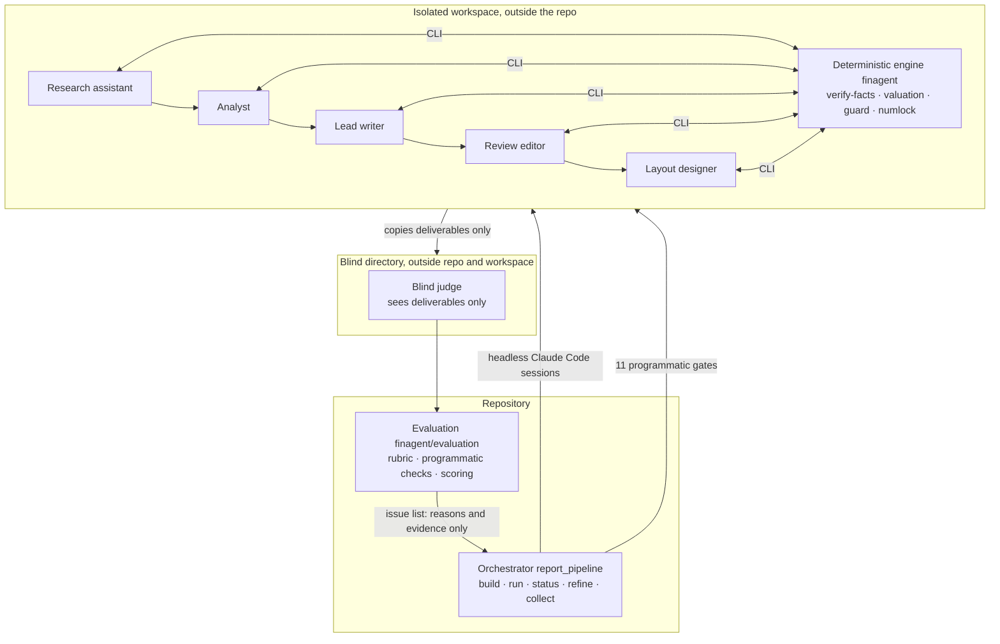

<div align="center">

# LEDGER

**L**LM-driven **E**quity Research with **D**eterministic **G**rounding, **E**valuation and **R**eporting

*A traceable multi-agent system for China A-share equity research: from an annual report to a sell-side-style research note.*

**English** · [简体中文](README.zh-CN.md)


Entry for the **2026 Beijing College Students' Financial AI Competition** (theme: building agents for investment research).

[Proposal (PDF)](paper/proposal/main.pdf) · [Technical report (PDF)](paper/techreport/main.pdf) · [Architecture](docs/architecture.md) · [Sample deliverables](report/交付/) · [Rubrics](eval/rubrics/README.md) · [Judge calibration](eval/calibration/report.md)

</div>

---

## What it does

You give LEDGER one A-share annual report as a PDF. You can also give it quarterly reports, a quoted share price with its source, and a list of peer companies. It produces:

- **A deep-dive research report** as a PDF in sell-side style: about 30–40 pages with at least 60 charts and tables, with a table of contents, a list of figures and a disclaimer.
- **A formula-linked valuation workbook** (`.xlsx`): a three-statement model, a three-scenario FCFF DCF with sensitivity tables, a reverse DCF and a comparable-company analysis.
- **Structured, traceable data**: every financial figure carries `{file, page, chunk, row, col}`, and every external number carries a registered source `[S#]`.
- **A quality scorecard** from a calibrated blind judge, plus a human review checklist.

The rule behind the whole system is one sentence:

> **The model reads, transcribes, writes and judges. The program verifies, computes and blocks.**

An LLM never does arithmetic in LEDGER. A number gets into the report only if it appears verbatim on the cited page of the source document, was computed by the deterministic engine from the single truth table, or comes from a registered external source whose quoted excerpt contains that exact number. Any other number is rejected.

## Competition tracks covered

| Level | Track | What LEDGER does | Code |
|---|---|---|---|
| Main | **Financial statement analysis** | Metric extraction with page anchors, YoY / QoQ, single-quarter decomposition, cross-statement tie-outs, anomaly signals, profit-change attribution, actual vs. consensus / earnings guidance, EPS quality | `finagent/tasks/financials/` |
| Main | **Automated valuation modeling** | Segment volume × price forecast → linked three-statement model → three-scenario FCFF DCF and sensitivities, reverse DCF, comps, rule-based rating, formula workbook | `finagent/tasks/valuation/` |
| Main | **Research report quality evaluation** | Four-layer rubric (L0 hard gates / L1 data closure / L2 analysis / L3 presentation and compliance / negative items), programmatic checks plus a blind judge, program-computed score, judge calibration, `refine` loop | `finagent/evaluation/` |
| Sub | **Data extraction** | The model transcribes from the PDF; each value is checked verbatim against its cited page and cross-checked by an independent rule-based channel (sparse grids, tables continued across pages, wrapped line items) | `finagent/parsing/`, `tasks/financials/` |
| Sub | **Industry-chain analysis** | Web research on the industry, competitors and peers, then a driver chain, deep-dive topics and an industry-chain map. External figures carry `[S#]` and must pass the guard | `.claude/skills/finagent-report/` |
| Sub | **Report error checking** | Extracts numeric claims from a draft report and checks each against the truth table. Each claim is labelled correct, value, unit, period, scope or direction error, or unverifiable, with the source and a fix. Also checks the report's internal consistency | `finagent/tasks/report_check/` |

## Problems we target

| Problem | Symptom | LEDGER's answer |
|---|---|---|
| Numeric hallucination | The model misremembers or invents figures, or mixes consolidated and parent-company figures | Each extracted value is checked verbatim on its cited page, and an independent rule channel cross-checks it. Any conflict blocks valuation |
| Unreliable computation | Growth rates, statement tie-outs and DCFs done "in the head" are random and cannot be reproduced | A deterministic engine does all computation, and every number in the prose must pass the numeric guard |
| Unsourced external facts | Market sizes, market shares and consensus figures are written from memory | Research comes first: each source is registered, its excerpt must contain the number, and the prose must cite `[S#]` |
| Quality is hard to measure | "Is it good?" is subjective, so improvements cannot be measured | A four-layer rubric: the program checks data closure, an isolated blind judge assesses analysis and writing, and the judge itself is calibrated |

## Architecture

LEDGER is a **multi-agent system whose harness is headless Claude Code**. A deterministic Python orchestrator, which is not a model, schedules five isolated production sessions and a blind judge. The roles share no context. They hand work over only through files in a workspace that sits outside the repository.



| Layer | What it is | Where |
|---|---|---|
| Harness | Headless Claude Code: one `claude -p --output-format stream-json` session per role, with the event stream saved to disk | `report_pipeline.agent_command` |
| Orchestrator | A deterministic Python state machine. It builds workspaces, launches sessions, judges gates, routes issues and keeps checkpoints for rollback | `finagent/report_pipeline.py` |
| Role instructions | Working manuals for the model: steps, constraints, commands, counter-examples | `.claude/skills/` (4 skills) + the generated workspace `CLAUDE.md` |
| Engine | Parsing, extraction checks, analysis, valuation, error checking, guards. Calls **no** model; standard library + `pdfplumber` only | `finagent/` (except `evaluation/`) |
| Evaluation | Programmatic checks, blind-judge session, rubric scoring, judge calibration | `finagent/evaluation/`, `eval/rubrics/` |

### Roles

| Role | Default model | Stages | Responsibility | Never does |
|---|---|---|---|---|
| Research assistant | Opus | 1 | Researches post-filing information on the web, registers `sources.json` and writes `dossier.md` | Extract financials or write the framework |
| Analyst | Opus | 2–7 | Extracts from the PDF and passes `verify-facts`; builds the analysis framework and deep-dive topics; runs targeted research, operating data and valuation assumptions; runs the valuation | Write the prose |
| Lead writer | Opus | 8 | Writes the "annual-report review + deep dive" narrative, which must pass the guard and the length gate | Change data or assumptions |
| Review editor | Sonnet | 9 | Did not write the draft. Edits wording and structure only, under the number lock. Moves uncertain items into `review.md` | Add or change numbers or conclusions |
| Layout designer | Opus | 10–11 | Writes the company-specific layout script, renders the PDF, checks it page by page and writes the delivery note | Change the body text |
| Blind judge | Sonnet | QA | Applies the rubric item by item in a directory that holds only the deliverables, with evidence and reasons | See the writing process, model names or point values |

Models are set with `FINAGENT_GEN_MODEL` / `FINAGENT_QC_MODEL` or on the command line.

### Why it is split this way

1. **Context isolation.** A reviewer that inherits the writer's conversation tends to follow the writer's reasoning, and a judge that sees the writing process grows lenient. So every role is its own session and talks to the others only through files.
2. **The workspace lives outside the repo.** The repo contains other companies' drafts and the rubric. A workspace holds only the three execution skills, the engine without `evaluation/`, and this one company's filings and inputs. Permissions forbid reading the repo or editing the engine and skills.
3. **The orchestrator is not a model.** Scheduling, gates, routing and stop conditions are code, so their behaviour is predictable and testable.
4. **The rubric is hidden from the generators.** Issue lists sent back contain only reasons and evidence. They never include rubric text or point values, which reduces overfitting to the rubric.

## Design invariants

| Invariant | What must always hold | Enforced by |
|---|---|---|
| The LLM does no arithmetic | Any derived number in the prose (growth, share, "about 3×") must exist in this run's computed artifacts | `guard` |
| Every number is traceable | Extractions carry `{file, page, chunk, row, col}`; transcribed numbers must appear verbatim on the cited page; external excerpts must contain the number | `verify-facts`, `verify-extra`, `verify-sources` |
| No silent pick between channels | If model extraction and the rule channel disagree, an issue is raised and valuation is blocked | `extract.merge`, gate 2 |
| One truth table | Valuation and error checking read only the `truth_table` produced by `analyze()` | Pipeline blocks before valuation |
| Full tracing | File reads and artifacts are hashed with SHA-256; steps and tool calls go to an event log; agent sessions are saved | `tracing.RunTracer`, `.pipeline/agents/` |
| False positives before recall | Error-check tolerance is half a unit in the last displayed digit; an error type is assigned only when an exact alternative explanation is found; forecasts and claims without truth values are "unverifiable" | `verify_claim` |
| Facts → inferences → opinions | Disclosed facts, program inferences and author opinions are kept apart; valuation states its assumptions, scope and risks | Writing skill; `guard` provenance classes |
| Rewrites are number-locked | The numbers and source IDs in a rewrite must be a subset of those in the draft | `numlock` |
| Research before analysis | External facts must be registered before they are cited | Gates 1 and 4 |
| No baked-in industry templates | Skills give method and constraints; drivers are derived by the model from the filings and dossier | `finagent-report` skill |

**Units:** financial facts are stored in CNY (元); valuation modules (three-statement, DCF, comps) use CNY millions with per-share values in CNY; ratios are stored as percentage values (14.49 means 14.49%).

## The 11-stage report pipeline

| Stage | Role | Artifact | Gate (checked by program) |
|---|---|---|---|
| 1 Research | Research assistant | `research/sources.json`, `dossier.md`, optional `peers.csv` | All 7 categories covered; ≥ 20 searches; ≥ 3 sources from the last 90 days; `verify-sources` passes |
| 2 Extraction | Analyst | `facts.json` → `facts.verified.json` | 0 rejections, 0 conflicts, 0 tie-out failures, and verification is newer than the last edit |
| 3 Framework | Analyst | `report/framework.md` | Has an external research list; ≥ 3 deep-dive topics |
| 4 Deep research | Analyst | `research/topics/*.md` | ≥ 3 topic notes, each ≥ 1,500 characters with ≥ 3 independent sources; ≥ 8 follow-up questions |
| 5 Operating data | Analyst | `extras.json` | `verify-extra` rejects 0 cells |
| 6 Assumptions | Analyst | `valuation_assumptions.json` | Share price with source; rationale cites `[S#]` |
| 7 Valuation | Analyst | `runs/<id>/valuation/` | Run is newer than all inputs and includes operating data and comps |
| 8 Narrative | Lead writer | `report/narrative.md` | `guard` (incl. sources) passes on the current draft; ≥ 15,000 characters, ≥ 60% deep dive |
| 9 Review | Review editor | `narrative.draft.md`, `edit_log.md`, `review.md` | Number lock passes |
| 10 Layout | Layout designer | `report/build_report.py` → PDF | PDF newer than prose and script; 25–32 pages; ≥ 60 figures; named |
| 11 Delivery note | Layout designer | `report/delivery.md` | File exists |

If a stage fails, every later stage is marked as failed too. When an input changes, downstream artifacts are marked stale. The count-based gates are only minimums; the blind judge is what checks quality.

## Quality loop

After all 11 gates pass, `refine` runs the blind judge and scores the report with the rubric (default `eval/rubrics/report_v2.json`):

| Layer | Items | Points | Judged by |
|---|---:|---:|---|
| L0 Hard gates | 5 | not scored; any failure caps the total at 40 | program |
| L1 Data closure | 13 | 35 | program |
| L2 Analysis quality | 12 | 45 | blind judge |
| L3 Presentation & compliance | 7 | 20 | blind judge |
| N Negative items | 4 | −30 (floor −20) | numeric self-contradiction by program, rest by judge |

**Delivery bar:** total ≥ 75, L1 / L2 / L3 hit rates ≥ 80% / 60% / 60%, and no negative item triggered. When a report falls short, each issue goes back to the right role. Data and assumption issues go to a revision session, after which review and layout run again. Wording and structure issues go to the review editor, and layout issues go to the layout designer. The loop stops after 3 rounds, after two consecutive rounds that each gain < 2 points, or when no issue can be routed. It then rolls back to the best-scoring round, and any unresolved items are appended to `review.md` for a human.

The judge is calibrated in three ways (`finagent/evaluation/calibrate.py` → [`eval/calibration/report.md`](eval/calibration/report.md)): stability across repeated blind judgments of the same draft, detection rate on seven programmatic degradations, and human-verified precision of its "fail" verdicts.

## Results

| Item | Result | Notes |
|---|---|---|
| Test suite | **176 passed**, 6 skipped | Skipped tests are item-by-item parity checks that need the local reference plugin |
| Sample benchmark | Extraction **35/35**; error check recall **100%**, precision **100%**, 0 false positives, error-type accuracy 100% | The samples are fictional and internally consistent, so this only shows the pipeline is correct |
| Real filings, rule channel | Moutai, CATL, China Merchants Energy Shipping: of **314** verified values the rule channel got **293**, with **0** mismatches | Used to cross-check model extraction |
| Report quality (blind judge) | Zhongji Innolight **90**, Unitree Robotics **88**, both meet the delivery bar | Up from 74 / 67 under rubric v1. The first three companies on the earlier pipeline scored 46–49 |
| Judge calibration | Item-level agreement across repeated judgments **86–91%**; total-score range 7–8; human-confirmed precision of "fail" verdicts **84%** | Detection is weak for whole-section deletions; see the calibration report |

Generated reports and valuation workbooks for Kweichow Moutai, CATL, China Merchants Energy Shipping, Zhongji Innolight and Unitree Robotics are in [`report/交付/`](report/交付/). Their per-item scorecards are in [`eval/results/`](eval/results/).

> Valuation parameters are drafted assumptions and share prices are external data. Conclusions depend heavily on those assumptions. **Nothing in this repository is investment advice.**

## Quick start

### Requirements

- **Python 3.12** (3.10+ works for the engine)
- For the full research-report pipeline only: **Node.js 18+**, **Claude Code** (logged in with `claude auth login` or `ANTHROPIC_API_KEY`), **Chrome / Chromium / Edge** (to print HTML to PDF), and CJK fonts

### Setup

```bash
git clone https://github.com/MochiaoChen/finagent.git
```

```bash
cd finagent && bash scripts/setup.sh
```

On Windows PowerShell:

```powershell
powershell -ExecutionPolicy Bypass -File scripts\setup.ps1
```

The setup script creates `.venv`, installs dependencies, checks for Claude Code, copies `.env.example` → `.env`, and runs the environment check. You can rerun the check at any time:

```bash
.venv/bin/python -m finagent.doctor
```

`doctor --live` sends one minimal request each to the generation and QA models (this may be billed). The commands below assume `.venv` is activated. Otherwise use `.venv/bin/python` on macOS / Linux or `.\.venv\Scripts\python.exe` on Windows.

### 1. Deterministic engine (no model calls)

Run the sample end to end. This uses the rule channel only, on a fictional company whose draft report has planted errors:

```bash
python -m finagent all --input data/samples/annual_report_2024.md --year 2024 --company 星河智造 --assumptions data/samples/valuation_assumptions.json --report data/samples/research_draft.md --peers data/samples/peers.csv --estimates data/samples/estimates.csv --guidance data/samples/guidance.csv
```

Outputs go to `runs/<timestamp>-all/`: the truth table, the analysis report, the valuation workbook, the error-check report and `trace.jsonl`.

Recompute a real company from the saved model extraction. This needs no model; the cited filing is in `report/resources/`:

```bash
python -m finagent verify-facts --input "report/resources/贵州茅台/600519_贵州茅台_2025_年度报告.pdf" --year 2025 --facts data/extractions/贵州茅台_2025/facts.json
```

```bash
python -m finagent valuation --input "report/resources/贵州茅台/600519_贵州茅台_2025_年度报告.pdf" --year 2025 --company 贵州茅台 --facts data/extractions/贵州茅台_2025/facts.json --extras data/extractions/贵州茅台_2025/extras.json --assumptions data/extractions/贵州茅台_2025/valuation_assumptions.json
```

This reruns only the computation on the saved inputs; it does not redo research, writing, layout or judging. Add quarterly reports with `--supplement <q.pdf>` (repeatable).

### 2. Multi-agent research report

```bash
python -m finagent.report_pipeline build --company 宁德时代 --year 2025 --price 250 --price-source "Exchange close 2026-10-05"
```

`build` prints the workspace path. Then generate the report and run QA on it (recommended):

```bash
python -m finagent.report_pipeline refine --workspace "<workspace>"
```

Use `run` to generate without QA, or `run --dry-run` to print only the five session commands. To check the gates at any time:

```bash
python -m finagent.report_pipeline status --workspace "<workspace>"
```

When every gate passes, collect the results back into the repo:

```bash
python -m finagent.report_pipeline collect --workspace "<workspace>" --label Opus
```

To compare models or configurations on the same company, build one workspace per `--tag`. Then run `scorecard --workspace A --workspace B` for a side-by-side table of objective counts.

### 3. Evaluation and calibration

```bash
python -m finagent.evaluation run --workspace "<workspace>"
```

```bash
python -m finagent.evaluation score --result eval/results/v2_中际旭创
```

```bash
python -m finagent.evaluation.calibrate report
```

### 4. Unified CLI and terminal UI

After `pip install -e ".[tui]"`, the `finagent` command is available (without installing, use `bin/finagent`):

| Command | Purpose |
|---|---|
| `finagent research <task>` | Engine tasks and checks (`financials`, `valuation`, `check`, `all`, `verify-facts`, `guard`, …) |
| `finagent report <subcommand>` | Report pipeline |
| `finagent eval` / `finagent calibrate` | QA / judge calibration |
| `finagent bench` / `finagent test` / `finagent doctor` | Sample benchmark / full test suite / environment check |
| `finagent ls` / `finagent tui` | List workspaces and runs / terminal UI (gates, truth-table provenance, valuation, item-level QA, trace replay, session logs) |

### 5. Tests and benchmark

```bash
python -m pytest -q tests
```

```bash
python eval/run_eval.py
```

## Repository layout

```
finagent/                 Deterministic engine (no model calls) + orchestrator + evaluation
  core/                   config · tracing (hashes, event log) · orchestrator · numbers (Chinese units, precision)
  parsing/                document (PDF/MD → page-anchored chunks; sparse grids, cross-page tables, wrapped items) · locate
  tasks/
    financials/           schema · extract (rule channel + merge) · external (model extraction + evidence check)
                          analyze (metrics, tie-outs, signals) · earnings · extras (operating data)
    valuation/            segment_forecast · three_statement + ts_engine · dcf · reverse_dcf · scenarios
                          scenario_tables · comps · forecast_summary (rating) · workbook + workbook_ts
    report_check/         claims · verify (claim checking and error diagnosis) · consistency
  output/                 report · xlsx · guard (numeric guard, provenance) · sources · numlock
  report_pipeline.py      Multi-agent orchestrator: build / run / status / refine / collect / scorecard
  evaluation/             Programmatic checks, blind judge, rubric scoring, calibration, workbook audit
  cli.py · catalog.py     Unified `finagent` CLI; read-only catalog of workspaces and runs
  doctor.py               Environment check
finagent_tui/             Terminal UI (Textual, optional)
.claude/skills/           finagent-pipeline · finagent-research · finagent-report (incl. reportkit) · finagent-review
data/samples/             Fictional sample company (annual + Q3 report, assumptions, peers, consensus, guidance, seeded draft)
data/extractions/         Collected extractions, operating data, assumptions, research and narratives per company
report/resources/         Source filings (public disclosures) with a SHA-256 manifest
report/交付/              Delivered report PDFs, valuation workbooks and human review checklists
eval/                     Sample gold labels · rubrics/ · results/ · calibration/ · review_pack/
paper/                    proposal/ (project proposal) · techreport/ (full technical report) · short paper (LaTeX)
docs/                     Architecture and design notes
promo/ · video/           Promo video projects (independent of the engine)
tests/                    pytest; golden/ holds output snapshots of the reference engines
```

Workspaces default to `~/finagent-samples/` and blind-judge directories to `~/finagent-evals/`. Both must be outside the repository tree.

## Reproducibility and traceability

- Every engine run writes `runs/<id>/trace.jsonl`. It records each file read and each artifact written with its SHA-256, plus each step and tool call with inputs and outputs.
- Every agent session's raw `stream-json` event log is saved to `.pipeline/agents/`. Turns, cost and tokens are summed in `.pipeline/agent_runs.json`.
- The source filings are committed with a hash manifest (`report/resources/manifest.json`), and the model extractions are in `data/extractions/`. Every valuation in `report/交付/` can be recomputed offline with the commands above.

## Known limitations

- Scanned pages are rejected; there is no OCR.
- The rule channel does not yet recognize quarterly-report column headers, so quarterly figures rely on model extraction plus tie-out checks.
- EBIT excludes investment income and fair-value changes. Investment assets must be added back through `non_operating_assets` in the assumptions file; otherwise the valuation is flagged as conservative.
- Operating expenses in the three-statement model are a plug. Asset-heavy industries that book depreciation in COGS can show a negative opex ratio, and the report says so.
- The liquidity stress test keeps the reference convention FCF × (1 + shock), so the direction flips when FCF is negative.
- The judge and generator come from the same model family. The rubric is still being calibrated, and scores are an internal QA measure.

## Third-party code and compliance

- The calculation engine is our own implementation. It follows the calculation conventions of OpenAI's *Public Equity Investing* plugin and contains **none** of its code. Parity is enforced with golden snapshots (`tests/test_golden.py`). The mapping, open-source dependencies and model usage are documented in [THIRD_PARTY.md](THIRD_PARTY.md).
- `promo/` builds on an AGPL-3.0 starter project, documented in `promo/LICENSE` and `promo/NOTICE.md`. It is independent of the engine.
- Annual reports and prospectuses in `report/resources/` are public disclosures; copyright remains with the issuers.
- All LLM reasoning uses Claude (Anthropic). The proposal explains this choice.

## Documentation

| Document | Contents |
|---|---|
| [Project proposal](paper/proposal/main.pdf) | Competition submission (Chinese, 95 pages) |
| [Technical report](paper/techreport/main.pdf) | Full technical report (Chinese) |
| [Short paper](paper/main.pdf) | Paper-style summary (Chinese) |
| [docs/architecture.md](docs/architecture.md) | End-to-end architecture walkthrough |
| [eval/rubrics/README.md](eval/rubrics/README.md) | Rubric design and versions |
| [eval/calibration/report.md](eval/calibration/report.md) | Judge calibration report |
| [THIRD_PARTY.md](THIRD_PARTY.md) | Third-party components and licenses |
| [CLAUDE.md](CLAUDE.md) | Development guide for coding agents |

## License

[MIT](LICENSE), except `promo/` (see `promo/LICENSE`) and third-party materials listed in [THIRD_PARTY.md](THIRD_PARTY.md).
