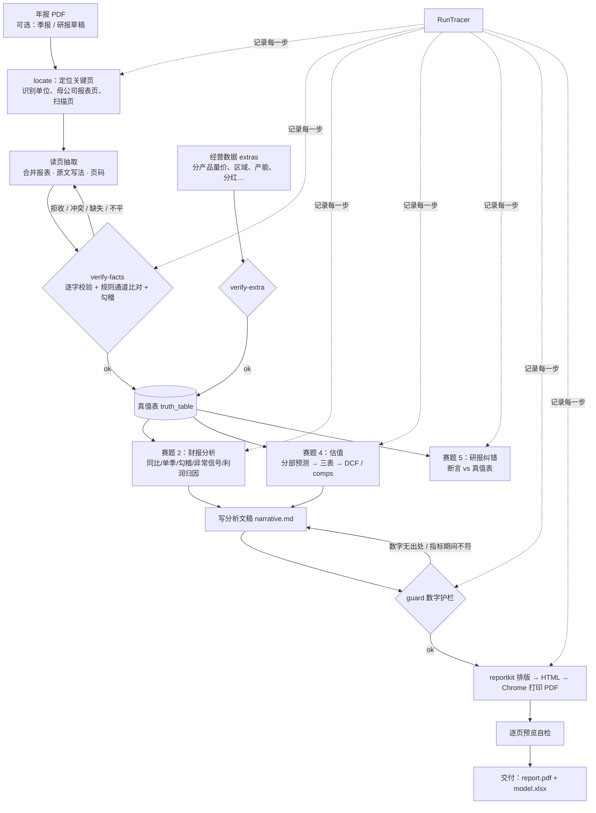
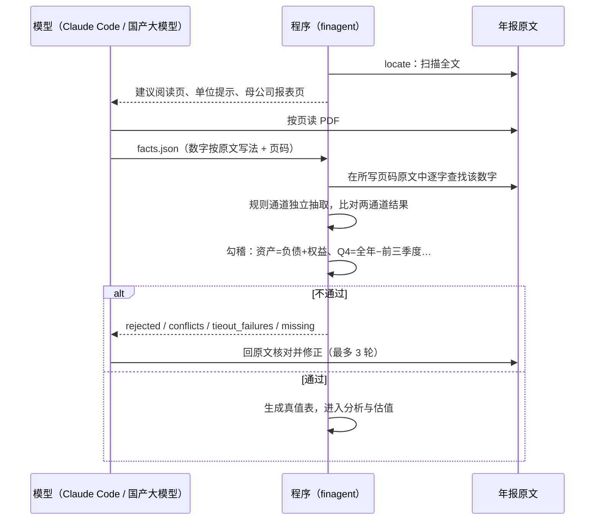
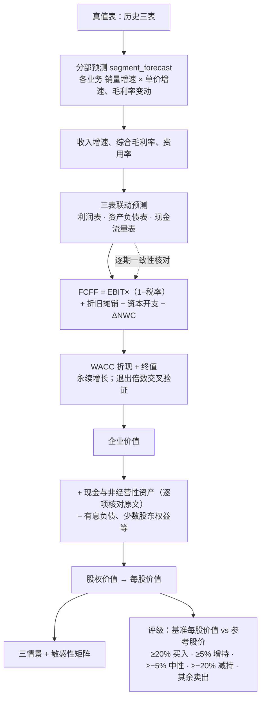
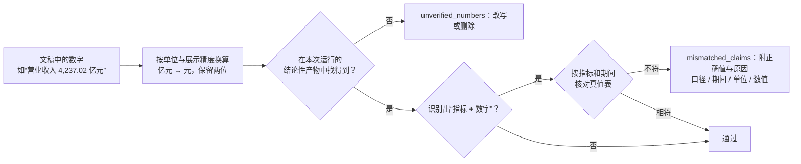
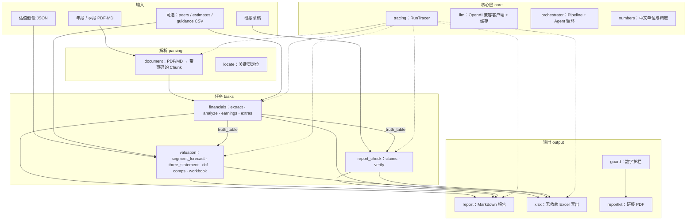

# FinAgent：可追溯的金融投研智能体

> 2026 北京市大学生金融人工智能竞赛（主题：金融投研智能体构建）参赛作品 · 产品需求文档（PRD）

输入一份 A 股年报（可附季报、研报草稿），输出一份**卖方体例的深度研报 PDF** 和一本**投行排版的估值模型 Excel**，
其中每个数字都能追溯到年报的具体页码，所有计算都由确定性代码完成。

| 选题 | 模块 | 核心产出 |
|---|---|---|
| 2 上市公司财务报告分析 | `finagent/tasks/financials/` | 指标表（附页码）、同比/环比、单季拆分与分季度勾稽、勾稽校验、异常信号、利润变动归因、实际 vs 一致预期/业绩预告、EPS 质量 |
| 4 自动化估值建模 | `finagent/tasks/valuation/` | 分部量价预测 → 三表联动 → 三情景 DCF（FCFF）+ 敏感性、可比公司估值、情景偏度、`model.xlsx` |
| 5 研究报告纠错核查 | `finagent/tasks/report_check/` | 逐条断言核查：正确 / 数值 / 单位 / 期间 / 口径 / 方向错误 / 无法核实，附来源与修改建议 |

---

## 1. 背景与问题

用大模型直接“读年报写研报”，有三个无法接受的问题：

| 问题 | 表现 | 对投研的后果 |
|---|---|---|
| **数字幻觉** | 模型编造或记错财务数字，心算增速、占比时出错 | 一个错数就会让整篇报告失去可信度 |
| **不可追溯** | 看不出数字来自年报哪一页、是合并还是母公司口径 | 评审和读者无法核对，无法复现 |
| **计算不可靠** | 让模型做 DCF、三表勾稽，结果随机、口径漂移 | 估值结论不可复现，也无法做敏感性分析 |

人工投研则慢：一份年报点评加估值模型，分析师需要数天完成抽数、建模、写作和排版。

## 2. 产品目标

**目标**

1. **准**：报告中每个数字都经过程序校验，要么能在年报原文逐字找到，要么由程序从原文数字算出。
2. **可追溯、可复现**：记录每次运行的全部文件读取、工具调用和计算；评审不调用任何模型即可复现全部结果。
3. **专业**：交付物达到卖方研报与投行模型的体例：事实、推论、观点分开，估值写明假设、适用范围与风险。
4. **快**：一家公司从年报到研报 PDF + 估值模型，在一次会话内完成（真实案例约 30 分钟）。

**非目标**

- 不做比赛选题 1、3、6、7。
- 不做 OCR：扫描页直接拒收。
- 不给出个性化投资建议：评级由程序按固定规则从估值结果得出，报告附免责声明。

## 3. 用户与场景

| 用户 | 场景 | 用到的功能 |
|---|---|---|
| 行业研究员 | 年报发布当天出一份深度点评 | 抽取 → 财报分析 → 估值 → 研报 PDF |
| 估值建模分析师 | 需要一个能改假设、能复算的模型 | `model.xlsx`（输入蓝、公式黑，情景切换）、敏感性矩阵 |
| 研报审核 / 合规 | 发布前核对研报草稿里的数字 | 研报纠错：逐条断言对照真值表 |
| 比赛评审 | 复现结果、检查数字来源 | `runs/<run_id>/` 追踪日志、`data/extractions/` 抽取文件、`--llm replay` |

## 4. 产品形态

计算引擎只有一套，两个版本的区别在于**谁来读文档、谁来调度**。

| | Agent 版本 | Skill 版本 |
|---|---|---|
| 读年报 / 研报 | pdfplumber 解析 + 规则通道为主，国产大模型（DeepSeek / 千问 / 智谱）补漏 | Claude Code 中的模型按页读 PDF 抽取，规则通道交叉校验 |
| 调度 | `python -m finagent all`（流水线）或 `ask`（程序内 Agent 循环） | Claude Code 按 `.claude/skills/finagent-research` 与 `finagent-report` 执行 |
| 大模型接入 | OpenAI 兼容 API，`.env` 配置；响应缓存于 `.cache/llm/` 供 `replay` 复现 | Claude Code 自身；抽取结果存 `data/extractions/` 供复现 |
| 研报 PDF | — | 支持（reportkit 排版，约 20 页） |
| 季报 | 暂不支持 | 支持（`--supplement`） |

两个版本在样例数据上逐项产出一致（`tests/test_skill.py`）。

**交付物**

| 交付物 | 内容 |
|---|---|
| 研报 PDF（约 20 页，红色主题） | 首页（标题观点、投资要点、评级、估值区间、盈利预测表）→ 目录与图表目录 → 业绩回顾 → 分业务量价 → 盈利能力 → 现金流与资本结构 → 盈利预测与估值 → 风险提示 → 附录（报表预测、方法说明、免责声明） |
| 估值模型 `model.xlsx` | 估值汇总、DCF、WACC、敏感性、三表模型（可切换情景）、分部预测、历史财务、分季度、经营数据 |
| 分析产物 | `financials/report.md`、`analysis.json`、`earnings.json`；`valuation/*.json`；`check/report.md`、`findings.csv` |
| 追踪记录 | `events.jsonl`（每次文件读取的哈希、步骤、工具调用、LLM 调用）、`manifest.json`（输入与产物哈希、配置、版本） |

---

## 5. 端到端流程

### 5.1 总体流程



### 5.2 抽取与校验：谁做什么

模型只负责“读”和“写”，程序负责“核”和“算”。



### 5.3 估值：分部预测驱动三表，三表驱动 DCF



没有量价数据的行业（如航运），可以不写分部预测，直接给出合并收入增速与毛利率路径，并在分析框架里说明原因。

### 5.4 研报生成


分析框架**不预设行业模板**：模型读完年报，自行推导这家公司的收入与利润驱动、领先指标和预测参数。
茅台看量价与渠道，宁德时代看 GWh 出货与单价、储能占比，招商轮船看船型分部与运价周期。

---

## 6. 功能需求

### 6.1 财报分析（赛题 2）

| 编号 | 需求 | 实现 |
|---|---|---|
| F2.1 | 抽取合并报表核心指标，附来源 `{文件, 页码, chunk, 行, 列}` | `extract.py`；Skill 版本 `verify-facts` |
| F2.2 | 同比、环比；季报单季拆分：Q2=H1−Q1、Q3=前三季度−H1、Q4=全年−前三季度 | `analyze.py` |
| F2.3 | 勾稽校验：资产负债表平衡、单季合计=全年等 | `analyze.py` |
| F2.4 | 异常信号：非经常性损益占比、利润与现金流背离、存货/应收增速高于收入、会计口径变化 | `analyze.py` |
| F2.5 | 利润变动归因桥；实际 vs 一致预期 / 业绩预告；EPS 质量 | `earnings.py` |
| F2.6 | 经营数据（分产品、区域、产销量、产能、分红）逐格核对，派生比率由程序计算 | `extras.py`、`verify-extra` |

### 6.2 估值建模（赛题 4）

| 编号 | 需求 | 实现 |
|---|---|---|
| F4.1 | 分部量价预测，单位可配置（吨、GWh…） | `segment_forecast.py` |
| F4.2 | 三表联动预测，逐期勾稽 | `three_statement.py`、`ts_engine.py` |
| F4.3 | FCFF DCF，三情景，WACC / 永续增长 / 退出倍数 | `dcf.py`、`build_plan.py` |
| F4.4 | 企业价值到股权价值的逐项估值桥，非经营性资产逐项核对原文 | `build_plan.py` |
| F4.5 | 多维敏感性、情景偏度 | `run.py`、`scenarios.py`、`scenario_tables.py` |
| F4.6 | 可比公司估值与利润率对比，与 DCF 交叉验证 | `comps.py` |
| F4.7 | 投行排版 Excel：输入蓝、公式黑、跨表绿，关键计算为公式 | `workbook.py`、`workbook_ts.py`、`output/xlsx.py` |

### 6.3 研报纠错（赛题 5）

| 编号 | 需求 | 实现 |
|---|---|---|
| F5.1 | 从研报中拆出可核验的数字断言 | `claims.py` |
| F5.2 | 与真值表逐条比对；容差按研报展示精度（半个末位） | `verify.py` |
| F5.3 | 错误分类：数值 / 单位 / 期间 / 口径 / 方向；只有找到精确匹配才下结论 | `verify.py` |
| F5.4 | 预测性表述、缺少真值的断言判“无法核实”，不计为错误 | `verify.py` |

### 6.4 研报生成

| 编号 | 需求 | 实现 |
|---|---|---|
| FR.1 | 约 20 页，带目录、图表目录（自动编号、回填页码） | `reportkit/layout.py` |
| FR.2 | 标准图表与表格，以及可组合的画图原语 | `reportkit/charts.py`、`tables.py` |
| FR.3 | 统一红色主题；正文 Times New Roman + 楷体，表格与图表数字用 Helvetica | `reportkit/core.py`、`report.css` |
| FR.4 | 正文数字全部通过 guard；评级取程序结果；统一免责声明 | `output/guard.py`、`reportkit/disclaimer.md` |

---

## 7. 设计思路

### 7.1 六条设计原则

1. **LLM 不做算术。** LLM 负责理解文本、抽取补漏、写文字解读和做任务规划；同比、占比、估值、勾稽全部由确定性 Python 完成。连“约三倍”“超过四成”这类心算约数也不允许。
2. **每个数字都能回到原文。** 抽取结果带来源定位；LLM 抽出的数字必须能在原文 chunk 里找到，否则丢弃。
3. **双通道不静默取舍。** 规则通道和 LLM 通道一致时记为 `rule+llm`；不一致时记为问题交人工复核，不偷偷选一个。
4. **一张真值表。** `analyze()` 产出的 `truth_table` 是估值和纠错的唯一数据来源。抽取有拒收、冲突、核心缺失或勾稽失败时，流水线在估值前停止。
5. **误报控制优先于召回。** 纠错容差按展示精度计算；错误类型必须找到精确匹配才下结论。
6. **可追溯、可复现。** 所有文件读取走 `tracing.read_file()`，所有产物走 `tracer.write_artifact()`，并记录哈希；LLM 响应按请求哈希缓存，`--llm replay` 离线复现。

### 7.2 数字护栏

模型写的每一句话在进入 PDF 前都要过 `guard`：



研报草稿里的数字不算出处。以后任何让 LLM 改写报告的功能都必须加“数字锁”：改写前后数字断言完全一致，否则拒绝输出。

### 7.3 报告的措辞分层

| 层次 | 措辞 | 例 |
|---|---|---|
| 事实 | 直接陈述，数字来自真值表 | 营业收入 281.77 亿元，同比增长 9.22% |
| 推论 | “主要系”“反映” | 扣非增速低于归母，主要系卖船收益计入非经常性损益 |
| 观点 | “我们认为”“我们预计” | 我们预计运价 2026 年见顶后回到周期中枢 |

估值参数、股价等年报之外的输入，都在出现处注明“假设”或数据来源。

### 7.4 单位约定

- 财务事实内部统一用**元**；估值模块（DCF、三表、comps）用**百万元**，每股用**元**。
- 比率存百分数值（14.49 表示 14.49%）。
- 同一页有多个“单位：”声明时，每张表按其上方最近的声明解析。

---

## 8. 系统架构



### 目录

```
finagent/
  core/          config · llm（OpenAI 兼容客户端 + 缓存）· tracing（追踪）· tools（Tool 注册）
                 orchestrator（Pipeline + Agent 循环）· numbers（中文单位 / 精度）
  parsing/       document（PDF/MD → 带页码锚点的 Chunk）· locate（关键页定位）
  tasks/
    financials/  schema（A 股指标字典）· extract（规则 + LLM + 证据校验）· analyze（计算 / 勾稽 / 信号）
                 earnings（归因桥、预期 / 预告对比、EPS 质量）· extras（经营数据与派生比率）
    valuation/   segment_forecast（分部量价）· three_statement + ts_engine（三表联动）· build_plan · dcf
                 run（执行 / 敏感性 / xlsx）· scenarios + scenario_tables · comps · forecast_summary（盈利预测与评级）
                 workbook + workbook_ts（Excel 模型）
    report_check/ claims（断言抽取）· verify（核查与错误诊断）
  output/        report（事实｜推论｜观点）· xlsx（Excel 写出与样式）· guard（数字护栏）
  prompts/       Prompt 模板
  pipelines.py   流水线与 Agent 工具注册
.claude/skills/
  finagent-research/  Skill 版本：抽取、校验、估值、纠错的流程规范
  finagent-report/    研报生成：reportkit（core · charts · tables · layout · report.css · disclaimer.md）与模板
data/
  samples/       样例：虚构公司年报、季报、估值假设、同业、一致预期、业绩预告、植入错误的研报草稿
  extractions/   每家公司的抽取文件、经营数据、估值假设、分析框架、文稿与编排脚本（随代码提交）
report/
  resources/     官方年报原件（贵州茅台、宁德时代、招商轮船 2025 年报）及 SHA-256 清单
  交付/          研报 PDF 与估值模型交付件
eval/            金标准与评测脚本
tests/           pytest；golden/ 为原插件引擎的产出快照（见 THIRD_PARTY.md）
```

---

## 9. 质量保证

| 手段 | 内容 | 当前结果 |
|---|---|---|
| 单元与集成测试 | `pytest -q tests`：流水线、Skill 与 Agent 一致性、季报拆分、三表、reportkit 在茅台 / 样例 / 亏损公司三种情形下渲染 | 本轮 110 个通过、5 个跳过；真实 DeepSeek 端到端结果另见 `sandbox/harness/`，不能由单测替代 |
| 评测 | `eval/run_eval.py`：字段抽取准确率，纠错召回率、准确率、误报数、错误类型准确率 | 样例上抽取 100%（35/35），纠错召回率与准确率均 100%，误报 0 |
| 引擎一致性 | `test_golden.py` 对比原插件引擎快照，必须完全相等；`test_parity_reference.py` 随机输入逐项对照 | 通过 |
| 真实年报 | 三家 2025 年报：facts 与 extras 校验 `ok: true`，文稿 guard `ok: true` | 见下表 |

样例数据是自造且内部完全自洽的，真实年报上的效果会明显低于样例指标。

### 真实公司案例（2025 年报）

| 公司 | 研报 | 基准每股价值 | 参考股价 | 程序评级 | 主线 |
|---|---|---:|---:|---|---|
| 贵州茅台 600519 | 21 页 | 1,531.40 元 | 1,237.00 元 | 买入 | 量价与渠道结构、直销占比 |
| 宁德时代 300750 | 21 页 · 62 个图表 | 383.31 元 | 291.11 元 | 买入 | 以量补价：GWh 出货、储能占比、海外收入；存货高增风险 |
| 招商轮船 601872 | 19 页 · 48 个图表 | 7.51 元 | 20.15 元 | 卖出 | 油轮贡献主要利润；运价周期见顶假设；在手订单与杠杆上升 |

估值参数均为起草的假设，股价为外部数据，结论高度依赖假设，不构成投资建议。
宁德时代和招商轮船的 Opus 正式版 PDF 与模型保存在 `report/交付/`；它们使用统一的红色研报主题。
`report/benchmarks/deepseek-v41-flash/` 另存 DeepSeek Flash 的原始试跑稿，仅用于模型对照，不经过真值表、数字护栏、估值建模和红色 PDF 排版流程，不能替代上述正式版。

---

## 10. 快速开始

推荐 Python 3.12 虚拟环境。macOS / Linux：

```bash
python3 -m venv .venv
```

```bash
.venv/bin/python -m pip install -r requirements.txt
```

Windows PowerShell：

```powershell
py -3.12 -m venv .venv
.\.venv\Scripts\python.exe -m pip install -r requirements.txt
```

研报打印会自动查找 Chrome / Edge；安装位置非默认时设置 `FINAGENT_CHROME`。样例 PDF 找不到中文字体时设置
`FINAGENT_CJK_FONT`（如 `C:\Windows\Fonts\simkai.ttf`）。

### 样例一键运行（无需 API Key）

```bash
python -m finagent all --input data/samples/annual_report_2024.md --year 2024 --company 星河智造 --assumptions data/samples/valuation_assumptions.json --report data/samples/research_draft.md --peers data/samples/peers.csv --estimates data/samples/estimates.csv --guidance data/samples/guidance.csv --llm off
```

只走规则通道。`--peers`、`--estimates`、`--guidance` 可选，缺省时跳过对应分析。产物在 `runs/<run_id>/`。
分任务运行：`python -m finagent financials|valuation|check ...`

### Skill 版本（Claude Code）

在 Claude Code 中打开本仓库，给出年报 PDF 并说明需求（如“为这份年报出一份深度研报和估值模型”）。
模型按 skill 依次执行 `locate → 读页抽取 → verify-facts → verify-extra → valuation → 写文稿 → guard → 排版`。

复现真实公司（以宁德时代为例，不调用任何模型）：

```bash
python -m finagent valuation --input "report/resources/宁德时代/300750_宁德时代_2025_年度报告.pdf" --year 2025 --company 宁德时代 --assumptions data/extractions/宁德时代_2025/valuation_assumptions.json --facts data/extractions/宁德时代_2025/facts.json --extras data/extractions/宁德时代_2025/extras.json --llm off
```

```bash
python data/extractions/宁德时代_2025/report/build_report.py --run-dir runs/<run_id>
```

辅助命令：`locate`（关键页定位）、`schema`（指标清单）、`verify-facts`、`verify-extra`、`guard`。
季报用 `--supplement 季报.pdf`（可多次），抽取条目写 `source_file`。

### 研报流水线（新公司出深度研报）

为新公司出研报时，不要在仓库里直接让模型开工：仓库里有其他公司的抽取、文稿和交付物，模型容易读进来浪费上下文、
照抄别家的框架。改用流水线搭一个**隔离工作区**，里面只有两个 skill、计算引擎、这一家公司的年报和外部输入：

```bash
python -m finagent.report_pipeline build --company 恒瑞医药 --year 2025 --allow-unverified --price <股价> --price-source "<来源>"
```

```bash
python -m finagent.report_pipeline run --workspace ~/finagent-samples/恒瑞医药_2025 --agent claude
```

```bash
python -m finagent.report_pipeline collect --workspace ~/finagent-samples/恒瑞医药_2025 --label Opus
```

- `build`：工作区默认建在 `~/finagent-samples/`（`--dest` 或 `FINAGENT_SAMPLES_DIR` 可改），必须在仓库目录树之外，
  避免 Claude Code 沿父目录加载仓库的 CLAUDE.md 和上级目录的原插件代码。目录结构与仓库一致，skill 里的路径照常可用。
  不在 `manifest.json` 已核验清单里的年报需要 `--allow-unverified`。股价、可比公司是外部数据，由人给出并注明来源。
- 工作区说明写在 `AGENTS.md`（Codex 直接读，`CLAUDE.md` 只有一行 `@AGENTS.md` 引用它），是流水线说明：8 个阶段（财务抽取 → 分析框架 → 经营数据 → 估值假设 → 估值运行 → 文稿 →
  排版 → 交付说明），每个阶段写明这时才读哪份 skill 文档、闸门是什么；明确不读引擎源码、运行产物全文和工作区外的内容。
  `.claude/settings.json` 禁止读仓库及上级目录、禁止改引擎和 skill。
- `status`（工作区内 `./py -m finagent.report_pipeline status`）逐阶段核对闸门：verify-facts / verify-extra 通过、
  最近三年核心财务指标不缺失且同一指标/期间不重复、
  估值运行晚于输入文件、guard 核对的是当前文稿、文稿无已知内部流程话术或占位符、PDF 晚于文稿与脚本。改了前面的文件，后面的阶段自动标为过期。
  上下文被压缩后模型先跑它，不必重读已完成阶段。
- `run --agent claude|codex|deepseek [--model ...]` 在工作区里无头执行（`claude -p` / `codex exec` / DeepSeek API），事件流存 `.pipeline/agents/`，
  耗时、token、费用（DeepSeek 暂不估价）记在 `.pipeline/agent_runs.json`；也可以在 Claude Code 或 Codex 里直接打开工作区，把 `TASK.md` 作为第一条消息。
  Claude Code 在未信任目录里会忽略 settings 的 allow，`run` 用 `--allowedTools` 传入同一份清单；deny 照常生效。
- `collect` 在闸门全部通过后把抽取与文稿收回 `data/extractions/<公司>_<年度>/`、运行目录收回 `runs/`、
  PDF 与估值模型放到 `report/交付/<MMDD> <公司> <label>/`。
- **测评**：同一公司、相同输入，`build --tag opus` / `--tag codex` 各搭一个工作区，分别 `run`，再
  `scorecard --workspace A --workspace B --out 对比.md` 出对比表（闸门、抽取规模、估值迭代次数、guard、字数、页数、图表、
  评级、DCF、耗时、token、费用）。这些是客观计数，不代表研报质量，分析深度要人读 PDF 判断。`collect --delivery-only`
  只收交付物，不覆盖抽取文件。
- **Skill 入口**：`finagent-pipeline`（`.claude/skills/`）把上面的流程写成 skill，Claude Code 和 Codex 都能调用；
  `.agents/skills/` 是给 Codex 等工具的入口（正文指向 `.claude/skills/`，改了 skill 描述后跑 `sync-skills`）。
  仓库根目录 `AGENTS.md` 指向 CLAUDE.md。
- 已知限制：Codex 路径未实测（本机无 Codex CLI）；Codex 沙箱只允许写工作区，无头 Chrome 打印 PDF 需要写用户目录，
  可能在排版阶段失败，届时在沙箱外补跑 `build_report.py`。

#### DeepSeek harness（macOS / Windows）

仓库根目录被 Git 忽略的 `.env` 中配置 `DEEPSEEK_API_KEY`，不要把密钥放入工作区、命令行参数或提交。
先用与 Claude/Codex **相同的年报、股价及来源** `build --tag deepseek`，再执行：

```bash
python -m finagent.report_pipeline run --workspace <工作区> --agent deepseek
python -m finagent.report_pipeline status --workspace <工作区>
python -m finagent.report_pipeline scorecard --workspace <工作区> --json
```

`deepseek-flash` 是默认模型；工具调用按阶段读取两个原版 skill、本公司 PDF 物理页和外部输入，只能写本公司抽取目录，
校验、估值、数字护栏和状态闸门仍由 FinAgent 程序执行。模型生成的报告脚本只在排版工具里运行，
不会继承 API Key。工作区需要在仓库目录树之外；它是**内容隔离，不是操作系统级安全沙箱**。
DeepSeek 执行器会沿用工作区 `build` 时选定的 Python 解释器；该解释器须安装项目依赖（包括 `pdfplumber`、`matplotlib`），
否则不能将“模型完成写作”误判为 PDF 排版通过。新增的文稿检查仅拦截已知写法，不等于核实了投资推断，
最终对比还需审读事实链、假设合理性及 PDF 图表。
工作区内 macOS/Linux 使用 `./py`，Windows 使用 `py.cmd`；建议在目标系统本机执行 `build`，不要把另一台机器生成的解释器包装器直接搬过去。
事件流、调用次数和 token 留在 `.pipeline/`；单次运行最多 80 次 API 调用，输入 100 万 token、输出 15 万 token，
达到上限保留进度并停止。短程联调可设 `FINAGENT_DEEPSEEK_MAX_CALLS=1`（范围 1–80）；
需要重新 `build` 工作区才能带入最新执行器代码。未通过 8 个闸门不能作为最终研报；测评记录放仓库 `sandbox/`，
实运行工作区仍留在仓库外。

### Agent 版本（国产大模型）

```bash
cp .env.example .env
```

在 `.env` 中填写 `LLM_BASE_URL`、`LLM_MODEL`、`LLM_API_KEY`（DeepSeek、通义千问、智谱等 OpenAI 兼容接口），然后：

```bash
python -m finagent all --input 年报.pdf --year 2024 --assumptions 假设.json --report 研报.pdf --llm live
```

Agent 模式（LLM 自主规划调用工具）：

```bash
python -m finagent ask "分析 data/samples/annual_report_2024.md（2024年报），再用 data/samples/valuation_assumptions.json 估值"
```

评审复现：`--llm replay` 只读 `.cache/llm/` 缓存，不访问网络，缺缓存直接报错。

### DeepSeek Flash 双公司对照测试（非正式研报）

先运行 `python -m finagent.deepseek_harness prepare`，从仓库内宁德时代、招商轮船年报抽取带 PDF 物理页码的证据包，并核对文件 SHA-256 和页数。要真实调用 DeepSeek 官方 API，在被 Git 忽略的 `.env` 中填写 `DEEPSEEK_API_KEY`，再运行 `python -m finagent.deepseek_harness run`。程序固定使用 `deepseek-flash`，启用 thinking / high reasoning effort；不会改动 Agent 版本的默认模型。

输出保存在 `runs/deepseek-v41-flash/`，包括证据包、分析框架、Markdown 初稿、基本引用检查及运行元数据。本次试跑的两份原始稿和具体人工复核问题在 `report/benchmarks/deepseek-v41-flash/`。自动检查只覆盖页码范围、数字段落引用和明显编辑占位符；它不能证明事实正确，也不生成红色主题 PDF。原始稿保留模型缺陷以便与 Opus 版对照，发布前必须回到真值表和年报逐项复核。

### 测试与评测

```bash
python -m pytest -q tests
```

```bash
python eval/run_eval.py
```

---

## 11. 合规与第三方

- 核心推理引擎优先使用国产模型（DeepSeek / 千问 / 智谱）。
- 输出为结构化数据、表格与报告，全程追踪可复现。
- 引擎全部自研；与原 OpenAI Public Equity Investing 插件的口径参照关系、第三方组件的名称、版本、来源、许可证与使用范围见
  [THIRD_PARTY.md](THIRD_PARTY.md)。

## 12. 已知限制与路线图

**已知限制**

- 扫描页直接拒收，不做 OCR；跨页表格、合并单元格仍依赖模型读页与程序校验兜底。
- EBIT 口径剔除投资收益与公允价值变动，预测期不含这两项；投资类资产需在假设文件 `non_operating_assets` 加回。
- 三表模型的经营费用是轧差项（毛利 − EBIT − 折旧摊销）。折旧计入营业成本的重资产行业（如航运）会出现负的经营费用率，报告中已注明。
- 流动性压力测试沿用原插件口径 FCF×(1+冲击)，FCF 为负时方向相反。
- Agent 版本暂只读单份报告，不支持季报。

**路线图**

- [x] 三个选题端到端跑通；引擎自研替代原插件，产出一致
- [x] Skill 版本：Claude Code 读 PDF + 程序校验计算；季报单季拆分
- [x] 三表驱动 DCF、分部量价预测、逐项股权价值桥、投行排版 Excel
- [x] 研报生成 skill（reportkit）；三家真实 2025 年报深度研报
- [ ] 导师风格改写：风格档案 → 格式合规检查 → LLM 改写 → 数字锁
- [ ] 扩充评测集：10～20 份真实财报 + 人工埋错研报
- [ ] Streamlit Web 界面与运行日志回放
- [ ] Agent 版本接入真实国产模型跑 `--llm live`，提交 `.cache/llm/` 供 replay
- [ ] Agent 版本跟进季报与新指标

**比赛节点**：2026-10-18 初赛提交（计划书 PDF + ≤5 分钟视频）；11 月底决赛（现场演示与答辩）。
