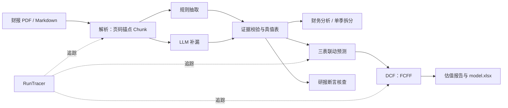
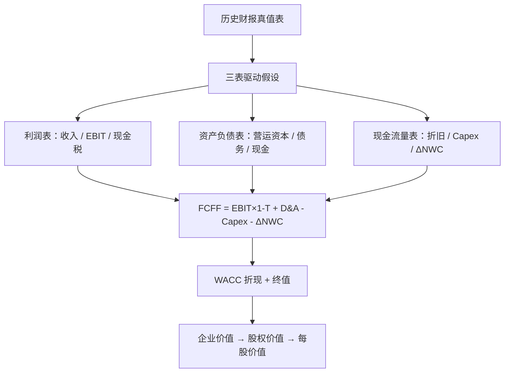

# FinAgent：可追溯的金融投研智能体

2026 北京市大学生金融人工智能竞赛参赛作品。覆盖以下选题：

| 选题 | 模块 | 输出 |
|---|---|---|
| 2. 上市公司财务报告分析 | `tasks/financials` | 指标表（附来源页码）、同比/环比、勾稽校验、异常信号（非经常性损益、利润现金流背离、营运资本错配、会计口径变化）、利润变动归因桥、实际 vs 一致预期/业绩预告、EPS 质量筛查 |
| 4. 自动化估值建模 | `tasks/valuation` | 三情景 DCF（FCFF）、三表联动预测与勾稽、可比公司相对估值（与 DCF 交叉验证）、情景偏度与多维敏感性、`model.xlsx` |
| 5. 研究报告纠错核查 | `tasks/report_check` | 逐条断言核查：正确 / 数值错误 / 单位错误 / 期间错配 / 口径错误 / 方向错误 / 无法核实，附来源与修改建议 |

## 设计原则

1. **LLM 不做算术。** LLM 负责理解非标准文本、抽取补漏、写文字解读和做任务规划；所有数值计算都由确定性代码完成。
2. **每个数字都能回到原文。** 抽取结果带 `{文件, 页码, chunk, 行, 列}`；LLM 的抽取结果必须能在原文中找到对应数字，否则丢弃（证据校验）。
3. **双通道交叉验证。** 规则通道和 LLM 通道的结果一致时记为 `rule+llm`；不一致时不静默取舍，而是记为问题，交人工复核。
4. **三个任务共用一张真值表。** 财报分析产出的“真值表”同时供估值和研报核查使用，三者口径一致。
5. **可追溯、可复现。** 每次运行生成 `runs/<run_id>/`，包括：`events.jsonl`（文件读取哈希、步骤、工具调用、LLM 调用）、`manifest.json`（输入/产物哈希、配置、版本）和全部产物。LLM 响应按请求哈希缓存；`LLM_MODE=replay` 可以离线复现。

```
财报 PDF/MD ─parse─▶ extract(规则+LLM) ─▶ analyze ─▶ 财报分析报告      [赛题2]
                                            │ 真值表
                                            ├─▶ build_plan ─▶ DCF ─▶ 估值报告+xlsx  [赛题4]
研报草稿 ───parse─▶ claims(规则+LLM) ──────┴─▶ verify ─▶ 核查报告     [赛题5]

全程：RunTracer → runs/<run_id>/events.jsonl + manifest.json
```

### 系统框架



### 三表驱动 DCF



关键口径：经营性 `EBIT = 利润总额 + 财务费用 − 投资收益 − 公允价值变动收益`；季报流量指标按
`Q2 = H1 − Q1`、`Q3 = 前三季度 − H1`、`Q4 = 全年 − 前三季度` 拆分，已有单季披露不会被覆盖。

## 目录

```
finagent/
  core/          config · llm（OpenAI 兼容客户端+缓存）· tracing（追踪）· tools（Tool 注册）
                 orchestrator（Pipeline + Agent 循环）· numbers（中文单位/精度）
  parsing/       document.py：PDF/MD → 带页码锚点的 Chunk
  tasks/
    financials/  schema（A股指标字典）· extract（规则+LLM+证据校验）· analyze（计算/勾稽/信号）
                 earnings（归因桥 + 预期/预告对比 + EPS 质量）
    valuation/   build_plan（财报→DCF 输入）· dcf（FCFF 引擎）· run（执行/敏感性/xlsx）
                 three_statement + ts_engine（三表联动）· scenarios + scenario_tables（情景偏度）
                 comps（相对估值 + 公式工作簿）
    report_check/ claims（断言抽取）· verify（核查与错误诊断）
  output/        report.py：Markdown/CSV 报告（事实｜推论｜观点）· xlsx.py：无依赖 xlsx 写出
  prompts/       *.md Prompt 模板
  pipelines.py   三条流水线 + Agent 工具注册
data/samples/    样例：虚构公司年报节选、估值假设、同业、一致预期、业绩预告、植入错误的研报草稿
eval/            金标准与评测脚本
tests/           pytest；golden/ 为原插件引擎产出的快照（见 THIRD_PARTY.md）
```

## 快速开始

```bash
pip install -r requirements.txt
```

```bash
python -m finagent all --input data/samples/annual_report_2024.md --year 2024 --company 星河智造 --assumptions data/samples/valuation_assumptions.json --report data/samples/research_draft.md --peers data/samples/peers.csv --estimates data/samples/estimates.csv --guidance data/samples/guidance.csv --llm off
```

不需要 API Key 就能跑通（只走规则通道）。`--peers`、`--estimates`、`--guidance` 可选，缺省时跳过对应分析。产物在 `runs/<run_id>/` 下：

- `financials/report.md`、`facts.csv`、`analysis.json`
- `financials/earnings.json`（归因桥、预期对比、业绩预告、EPS 质量）
- `valuation/report.md`、`model.xlsx`（DCF + 三表 + 可比公司）、`comps_formula_workbook.xlsx`（带公式、可在 Excel 中复算的 comps 表）、`three_statement.json`、`scenarios.json`、`comps.json`
- `check/report.md`、`findings.csv`

分任务运行：`python -m finagent financials|valuation|check ...`

### 启用大模型

```bash
cp .env.example .env
```

在 `.env` 中填写 `LLM_BASE_URL`、`LLM_MODEL`、`LLM_API_KEY`，支持 DeepSeek、通义千问、智谱等 OpenAI 兼容接口。然后：

```bash
python -m finagent all --input 年报.pdf --year 2024 --assumptions 假设.json --report 研报.pdf --llm live
```

Agent 模式（由 LLM 自主规划调用工具）：

```bash
python -m finagent ask "分析 data/samples/annual_report_2024.md（2024年报），再用 data/samples/valuation_assumptions.json 估值"
```

### 复现（评审用）

```bash
python -m finagent all ... --llm replay
```

`replay` 模式只读取 `.cache/llm/` 中的缓存，不访问网络；如果缺少缓存会直接报错。提交代码时需一并提交 `.cache/llm/`。

### 评测与测试

```bash
python eval/run_eval.py
```

```bash
python -m pytest -q tests
```

`run_eval.py` 输出字段抽取准确率，以及纠错的召回率、准确率、误报数和错误类型准确率。

与原 Public Equity Investing 插件引擎的一致性：`tests/test_golden.py` 始终运行（对比 `tests/golden/` 快照）；
`tests/test_parity_reference.py` 在能找到原插件时逐项对照随机输入（`FINAGENT_REFERENCE_PLUGIN=<插件目录>`，否则跳过）。

## 待办

- [ ] 真实 A 股年报 PDF 联调（pdfplumber 表格跨页、合并单元格）；扫描件接入 OCR
- [ ] 扩充评测集：10～20 份真实财报 + 人工植入错误的研报
- [x] 季报：单季拆分（Q2/Q3/Q4）与环比
- [x] 估值：EBIT 剔除投资收益、公允价值变动；DCF 预测由三表模型驱动
- [ ] Web 界面（Streamlit）与运行日志回放页
- [ ] 研报核查：估值倍数（PE/PB）核查（需要股价数据）

第三方组件见 [THIRD_PARTY.md](THIRD_PARTY.md)。
