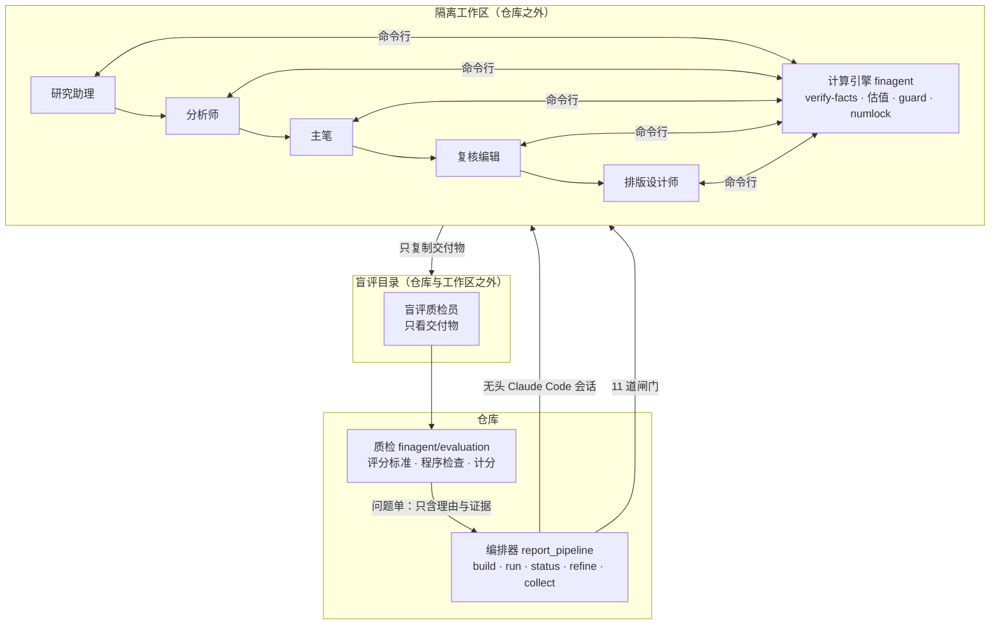

<div align="center">

# LEDGER

**L**LM-driven **E**quity Research with **D**eterministic **G**rounding, **E**valuation and **R**eporting

*可追溯的 A 股投研多智能体系统：从一份年报到一份卖方体例的深度研报*

[English](README.md) · **简体中文**


**2026 北京市大学生金融人工智能竞赛**（主题：金融投研智能体构建）参赛作品

[项目计划书（PDF）](paper/proposal/main.pdf) · [完整技术报告（PDF）](paper/techreport/main.pdf) · [架构说明](docs/architecture.md) · [交付样例](report/交付/) · [评分标准](eval/rubrics/README.md) · [评审校准](eval/calibration/report.md)

</div>

---

## 做什么

输入一份 A 股年报 PDF，可附季报、人给的股价及来源、可比公司名单。输出：

- **深度研报 PDF**（卖方体例，约 30～40 页、60 个以上图表），带目录、图表目录和免责声明；
- **公式联动的估值模型**（`.xlsx`）：三表模型、三情景 FCFF DCF 与敏感性、反向 DCF、可比公司估值；
- **结构化、可追溯的数据**：每个财务数字带 `{文件, 页码, chunk, 行, 列}`，每个外部数字带登记过的来源 `[S编号]`；
- **质检计分卡**：经过校准的盲评打分，外加人工复核清单。

整套系统只有一条分工原则：

> **模型读、抄、写、判断；程序校验、计算、拦截。**

LEDGER 里大模型不做任何算术。一个数字能进报告，只有三种情况：它在所引页的原文里逐字出现；它由确定性引擎从唯一的真值表算出；它登记在外部来源表里，且摘句包含这个数字。其他数字一律拒收。

## 覆盖的选题

| 层级 | 选题 | LEDGER 做什么 | 代码 |
|---|---|---|---|
| 主选题 | **财报分析** | 指标抽取（附页码）、同比 / 环比、单季拆分、三表勾稽、异常信号、利润变动归因、实际 vs 一致预期 / 业绩预告、EPS 质量 | `finagent/tasks/financials/` |
| 主选题 | **自动化估值建模** | 分部量价预测 → 三表联动 → 三情景 FCFF DCF 与敏感性、反向 DCF、可比公司、程序评级、公式工作簿 | `finagent/tasks/valuation/` |
| 主选题 | **研究报告质量评估** | 四层评分标准（L0 硬闸门 / L1 数据闭合 / L2 分析质量 / L3 表达合规 / 负向）、程序检查 + 盲评、程序计分、评审校准、`refine` 闭环 | `finagent/evaluation/` |
| 子选题 | **数据提取** | 模型读 PDF 抄数，逐字回查所引页，再由独立的规则通道交叉校验（稀疏网格、跨页续表、科目折行） | `finagent/parsing/`、`tasks/financials/` |
| 子选题 | **产业链分析** | 联网搜集行业、竞争、可比公司资料 → 驱动链 → 深度专题与产业链图；外部数字带 `[S编号]` 并过护栏 | `.claude/skills/finagent-report/` |
| 子选题 | **研究报告纠错核查** | 抽研报数字断言，与真值表逐条核对：正确 / 数值 / 单位 / 期间 / 口径 / 方向错误 / 无法核实，附来源与修改建议；研报内部一致性 | `finagent/tasks/report_check/` |

## 要解决的问题

| 问题 | 表现 | LEDGER 的做法 |
|---|---|---|
| 数字幻觉 | 模型记错或编造财务数字，混用合并与母公司口径 | 抽取逐字回查原文，规则通道独立取数交叉校验，冲突即阻断估值 |
| 计算不可靠 | 模型心算增速、三表勾稽、DCF，结果随机、不可复现 | 全部计算交给确定性引擎；文稿里的每个数字过数字护栏 |
| 外部信息无出处 | 行业规模、份额、一致预期凭记忆写 | 先联网搜集、登记来源（摘句须含该数字），正文外部数字必须带 `[S编号]` |
| 质量难以评价 | “好不好”靠主观判断，改进无法度量 | 四层评分标准：程序判数据闭合，隔离的盲评判分析与表达；评审模型本身先校准 |

## 系统架构

LEDGER 是一个**以无头 Claude Code 为 harness 的多 Agent 系统**。确定性的 Python 编排器（不是模型）调度五个互相隔离的生产会话和一个盲评质检员。角色之间不共享上下文，只通过仓库之外工作区里的文件交接。



| 层 | 是什么 | 位置 |
|---|---|---|
| Harness | 无头 Claude Code：每个角色一次 `claude -p --output-format stream-json` 会话，事件流落盘 | `report_pipeline.agent_command` |
| 编排器 | 确定性 Python 状态机：搭工作区、起会话、判闸门、路由问题单、存档回滚 | `finagent/report_pipeline.py` |
| 角色说明 | 写给模型的工作说明书：步骤、约束、命令、反例 | `.claude/skills/` 四个 skill + 工作区 `CLAUDE.md` |
| 计算引擎 | 解析、抽取校验、分析、估值、纠错、护栏；**不调用任何模型**，只用标准库与 pdfplumber | `finagent/`（除 `evaluation/`） |
| 质检 | 程序检查、盲评会话、评分标准计分、评审校准 | `finagent/evaluation/`、`eval/rubrics/` |

### 角色与模型

| 角色 | 默认模型 | 阶段 | 职责 | 不做什么 |
|---|---|---|---|---|
| 研究助理 | Opus | 1 | 联网搜集年报之后的信息，登记 `sources.json`，写资料包 `dossier.md` | 不抽财务数据、不写框架 |
| 分析师 | Opus | 2～7 | 读 PDF 抽取并过 `verify-facts`；分析框架与深度专题；深度调研；经营数据；估值假设；估值运行 | 不写文稿 |
| 主笔 | Opus | 8 | 写“年报点评 + 深度研究”文稿，过护栏与篇幅闸门 | 不改数据与假设 |
| 复核编辑 | Sonnet | 9 | 没有参与写作；只改措辞与结构，过数字锁；拿不准的写进 `review.md` | 不新增或改动数字、不改结论 |
| 排版设计师 | Opus | 10～11 | 写本公司排版脚本，渲染 PDF，逐页检查，写交付说明 | 不改正文 |
| 盲评质检员 | Sonnet | 质检 | 在只含交付物的目录里按评分标准逐条判定，给证据与理由 | 看不到写作过程、模型名、分值 |

模型可用 `FINAGENT_GEN_MODEL` / `FINAGENT_QC_MODEL` 或命令行参数替换。

### 为什么这样分

1. **上下文隔离。** 复核者若继承写作者的对话，会沿用写作者的思路；评审若看到写作过程，会变得宽容。所以每个角色都是独立会话，只读写工作区文件。
2. **工作区在仓库之外。** 仓库里有别家公司的文稿和评分标准。工作区只放三个执行 skill、计算引擎（不含 `evaluation/`）和这一家公司的年报与外部输入；权限配置禁止读取仓库、禁止修改引擎与 skill。
3. **编排器不是模型。** 调度、闸门、路由、停止条件都写成代码，行为可预期、可测试。
4. **评分标准对生成方不可见。** 回传的问题单只含理由与证据，不含条目原文与分值，减轻对评分标准的过拟合。

## 设计规范

| 规范 | 不变量 | 执行机制 |
|---|---|---|
| LLM 不做算术 | 文稿中的派生数（增速、占比、约数）必须出现在本次运行的计算产物中 | `guard` |
| 每个数字可追溯 | 抽取带 `{文件, 页码, chunk, 行, 列}`；模型抄的数字必须在所引页逐字出现；外部摘句必须包含该数字 | `verify-facts`、`verify-extra`、`verify-sources` |
| 双通道不静默取舍 | 模型抽取与规则通道不一致时生成问题记录并阻断估值 | `extract.merge`、阶段 2 闸门 |
| 一张真值表 | 估值与纠错只读 `analyze()` 产出的 `truth_table` | 流水线在估值前阻断 |
| 全程追踪 | 文件读取与产物记录 SHA-256；步骤、工具调用写事件流；会话事件流另存 | `tracing.RunTracer`、`.pipeline/agents/` |
| 误报控制优先 | 纠错容差取展示精度的半个末位；错误类型须找到精确的替代解释；预测与缺真值判“无法核实” | `verify_claim` |
| 事实 → 推论 → 观点 | 披露事实 / 程序推论 / 作者观点分层；估值写明假设、适用范围、风险 | 写作 skill；`guard` 出处分类 |
| 改写加数字锁 | 改写稿的数字与来源编号必须是初稿的子集 | `numlock` |
| 先搜集、后分析 | 外部事实先登记后引用 | 阶段 1、4 闸门 |
| 不预设行业框架 | skill 只给方法与约束，驱动由模型从年报与资料包推导 | `finagent-report` skill |

**单位约定**：财务事实用元；估值模块（三表、DCF、comps）用百万元，每股用元；比率存百分数值（14.49 表示 14.49%）。

## 研报流水线：11 个阶段与闸门

| 阶段 | 角色 | 产物 | 闸门（程序判） |
|---|---|---|---|
| 1 资料搜集 | 研究助理 | `research/sources.json`、`dossier.md`、可选 `peers.csv` | 七个类别全覆盖；检索 ≥ 20 次；近 90 天来源 ≥ 3 个；`verify-sources` 通过 |
| 2 财务抽取 | 分析师 | `facts.json` → `facts.verified.json` | 拒收、冲突、勾稽失败均为 0，且校验晚于修改 |
| 3 分析框架 | 分析师 | `report/framework.md` | 含“外部调研清单”，深度专题 ≥ 3 个 |
| 4 深度调研 | 分析师 | `research/topics/*.md` | 专题笔记 ≥ 3 份，每份 ≥ 1500 字、≥ 3 个独立来源；补充检索 ≥ 8 个问题 |
| 5 经营数据 | 分析师 | `extras.json` | `verify-extra` 拒收 0 格 |
| 6 估值假设 | 分析师 | `valuation_assumptions.json` | 有股价及来源；依据引用 `[S编号]` |
| 7 估值运行 | 分析师 | `runs/<id>/valuation/` | 运行晚于全部输入，且带上经营数据与可比公司表 |
| 8 文稿 | 主笔 | `report/narrative.md` | `guard`（含来源）通过且核对的是当前稿；正文 ≥ 15,000 字、深度研究 ≥ 60% |
| 9 复核改写 | 复核编辑 | `narrative.draft.md`、`edit_log.md`、`review.md` | 数字锁通过 |
| 10 排版 | 排版设计师 | `report/build_report.py` → PDF | PDF 晚于文稿与脚本；25～32 页；图表 ≥ 60；已命名 |
| 11 交付说明 | 排版设计师 | `report/delivery.md` | 文件存在 |

前序阶段没过，后续阶段一律判未通过；输入文件改动会让下游产物判为“过期”。数量闸门只是下限，质量由盲评兜底。

## 质检闭环

`refine` 在 11 道闸门全部通过后启动盲评，按评分标准（默认 `eval/rubrics/report_v2.json`）计分：

| 层 | 条目 | 分值 | 判定 |
|---|---:|---:|---|
| L0 硬闸门 | 5 | 不计分，任一失败封顶 40 | 程序 |
| L1 数据闭合 | 13 | 35 | 程序 |
| L2 分析质量 | 12 | 45 | 盲评 |
| L3 表达与合规 | 7 | 20 | 盲评 |
| N 负向 | 4 | −30（下限 −20） | 数字前后矛盾由程序判，其余盲评 |

**交付标准**：总分 ≥ 75，L1 / L2 / L3 得分率分别 ≥ 80% / 60% / 60%，且不命中负向条目。未达标时问题单按类型回传：数据与假设问题交修订会话（之后复核、排版重新跑），措辞与结构问题交复核编辑，版面问题交排版设计师。满 3 轮、连续两轮提升都不足 2 分或无可回传问题时停止，回滚到得分最高的一轮；仍未解决的问题追加进 `review.md` 交人工。

评审模型本身用三组证据校准（`finagent/evaluation/calibrate.py` → [`eval/calibration/report.md`](eval/calibration/report.md)）：同稿重复盲评的稳定性、七种程序劣化的判出率、人工复核“判不通过”的精确率。

## 当前结果

| 项目 | 结果 | 说明 |
|---|---|---|
| 测试 | **176 通过**，6 跳过 | 跳过的是需要本地原参照插件的逐项对照测试 |
| 样例评测 | 抽取 **35/35**；纠错召回率 **100%**、准确率 **100%**、误报 0、错误类型准确率 100% | 样例为虚构且自洽，只说明流程正确 |
| 真实年报（规则通道） | 茅台、宁德、招商 **314** 个核验值，规则通道取到 **293** 个，错配 **0** | 用于交叉校验模型抽取 |
| 研报质检（盲评） | 中际旭创 **90**、宇树科技 **88**，均达交付标准 | 评分标准 v1 时为 74 / 67；早期三家（旧流程）46～49 |
| 评审校准 | 重复盲评逐条一致 **86%～91%**，总分极差 7～8；判出问题人工确认精确率 **84%** | 整节删除类劣化判出率低，见校准报告 |

贵州茅台、宁德时代、招商轮船、中际旭创、宇树科技的研报与估值模型见 [`report/交付/`](report/交付/)，逐条计分卡见 [`eval/results/`](eval/results/)。

> 估值参数均为起草的假设，股价为外部数据，结论高度依赖假设。**本仓库任何内容均不构成投资建议。**

## 快速开始

### 环境要求

- **Python 3.12**（计算引擎 3.10+ 即可）
- 仅完整研报流水线需要：**Node.js 18+**、已登录的 **Claude Code**（`claude auth login` 或 `ANTHROPIC_API_KEY`）、**Chrome / Chromium / Edge**（HTML 打印 PDF）与中文字体

### 安装

```bash
git clone https://github.com/MochiaoChen/finagent.git
```

```bash
cd finagent && bash scripts/setup.sh
```

Windows PowerShell：

```powershell
powershell -ExecutionPolicy Bypass -File scripts\setup.ps1
```

脚本会建 `.venv`、装依赖、检查 Claude Code、把 `.env.example` 复制为 `.env` 并做环境自检。之后随时可以再自检：

```bash
.venv/bin/python -m finagent.doctor
```

`doctor --live` 会向生成与质检模型各发一次最小请求，可能计费。以下命令假定已激活 `.venv`；否则 macOS / Linux 用 `.venv/bin/python`，Windows 用 `.\.venv\Scripts\python.exe`。

### 1. 计算引擎（不调用模型）

样例端到端（只走规则通道；虚构公司，研报草稿里埋了错）：

```bash
python -m finagent all --input data/samples/annual_report_2024.md --year 2024 --company 星河智造 --assumptions data/samples/valuation_assumptions.json --report data/samples/research_draft.md --peers data/samples/peers.csv --estimates data/samples/estimates.csv --guidance data/samples/guidance.csv
```

产物在 `runs/<时间戳>-all/`：真值表、分析报告、估值工作簿、纠错报告和 `trace.jsonl`。

用仓库里保存的模型抽取复算真实公司（不需要模型；年报原件在 `report/resources/`）：

```bash
python -m finagent verify-facts --input "report/resources/贵州茅台/600519_贵州茅台_2025_年度报告.pdf" --year 2025 --facts data/extractions/贵州茅台_2025/facts.json
```

```bash
python -m finagent valuation --input "report/resources/贵州茅台/600519_贵州茅台_2025_年度报告.pdf" --year 2025 --company 贵州茅台 --facts data/extractions/贵州茅台_2025/facts.json --extras data/extractions/贵州茅台_2025/extras.json --assumptions data/extractions/贵州茅台_2025/valuation_assumptions.json
```

这只在已保存的输入上复算，不重新做调研、写作、排版或盲评。季报用 `--supplement 季报.pdf`（可多次）。

### 2. 多 Agent 研报流水线

```bash
python -m finagent.report_pipeline build --company 宁德时代 --year 2025 --price 250 --price-source "交易所收盘价 2026-10-05"
```

`build` 打印工作区路径。生成并质检（推荐）：

```bash
python -m finagent.report_pipeline refine --workspace "<工作区路径>"
```

只生成、不质检用 `run`（`--dry-run` 只打印五个会话的命令）。随时查看闸门：

```bash
python -m finagent.report_pipeline status --workspace "<工作区路径>"
```

闸门全部通过后收回仓库：

```bash
python -m finagent.report_pipeline collect --workspace "<工作区路径>" --label Opus
```

同一公司比较不同模型或配置时，用不同 `--tag` 各建一个工作区，再用 `scorecard --workspace A --workspace B` 并排比较客观计数。

### 3. 质检与校准

```bash
python -m finagent.evaluation run --workspace "<工作区路径>"
```

```bash
python -m finagent.evaluation score --result eval/results/v2_中际旭创
```

```bash
python -m finagent.evaluation.calibrate report
```

### 4. 统一命令行与终端界面

`pip install -e ".[tui]"` 后可直接用 `finagent`（不安装时用 `bin/finagent`）：

| 命令 | 作用 |
|---|---|
| `finagent research <任务>` | 引擎任务与校验命令（`financials`、`valuation`、`check`、`all`、`verify-facts`、`guard`…） |
| `finagent report <子命令>` | 研报流水线 |
| `finagent eval` / `finagent calibrate` | 质检 / 评审校准 |
| `finagent bench` / `finagent test` / `finagent doctor` | 样例评测 / 全部测试 / 环境自检 |
| `finagent ls` / `finagent tui` | 列出工作区与运行目录 / 终端界面（闸门、真值表来源回溯、估值、质检逐条、追溯回放、会话日志） |

### 5. 测试与评测

```bash
python -m pytest -q tests
```

```bash
python eval/run_eval.py
```

## 目录

```
finagent/                 计算引擎（不调用模型）+ 编排器 + 质检
  core/                   config · tracing（哈希与事件流）· orchestrator · numbers（中文单位 / 精度）
  parsing/                document（PDF/MD → 带页码锚点的 Chunk；稀疏网格、跨页续表、科目折行）· locate
  tasks/
    financials/           schema · extract（规则通道 + 合并）· external（模型抽取与证据校验）
                          analyze（计算 / 勾稽 / 信号）· earnings · extras（经营数据）
    valuation/            segment_forecast · three_statement + ts_engine · dcf · reverse_dcf · scenarios
                          scenario_tables · comps · forecast_summary（评级）· workbook + workbook_ts
    report_check/         claims · verify（核查与错误诊断）· consistency（内部一致性）
  output/                 report · xlsx · guard（数字护栏与出处分类）· sources · numlock
  report_pipeline.py      多 Agent 编排器：build / run / status / refine / collect / scorecard
  evaluation/             程序检查、盲评会话、评分标准计分、校准、工作簿审计
  cli.py · catalog.py     统一命令行 `finagent`；工作区与运行产物的只读目录
  doctor.py               环境自检
finagent_tui/             终端界面（Textual，可选）
.claude/skills/           finagent-pipeline · finagent-research · finagent-report（含 reportkit）· finagent-review
data/samples/             虚构样例公司（年报、三季报、假设、同业、一致预期、业绩预告、埋错研报草稿）
data/extractions/         各公司收回的抽取、经营数据、假设、调研与文稿
report/resources/         年报原件（公开披露文件）与 SHA-256 清单
report/交付/              研报 PDF、估值工作簿与人工复核清单
eval/                     样例金标准 · rubrics/ · results/ · calibration/ · review_pack/
paper/                    proposal/（项目计划书）· techreport/（完整技术报告）· 短论文（LaTeX）
docs/                     架构说明与设计记录
promo/ · video/           宣传片工程（与引擎互不依赖）
tests/                    pytest；golden/ 为参照引擎的产出快照
```

工作区默认在 `~/finagent-samples/`，盲评目录默认在 `~/finagent-evals/`，都必须在仓库目录树之外。

## 可复现与可追溯

- 每次引擎运行都写 `runs/<id>/trace.jsonl`：每次文件读取、每个产物都记 SHA-256，每个步骤和工具调用都记输入输出。
- 每个 Agent 会话的原始 `stream-json` 事件流存在 `.pipeline/agents/`，轮数、费用、token 汇总在 `.pipeline/agent_runs.json`。
- 年报原件随仓库提交并附哈希清单（`report/resources/manifest.json`），模型抽取在 `data/extractions/`；`report/交付/` 里的每个估值都能用上面的命令离线复算。

## 已知限制

- 扫描页直接拒收，不做 OCR。
- 规则通道尚不识别季报表头，季报只靠模型抽取 + 勾稽校验。
- EBIT 剔除投资收益与公允价值变动；投资类资产需在假设文件 `non_operating_assets` 加回，否则报告提示估值偏保守。
- 三表模型的经营费用是轧差项；折旧计入营业成本的重资产行业会出现负的经营费用率，报告中已注明。
- 流动性压力测试沿用参照口径 FCF ×（1 + 冲击），FCF 为负时方向相反。
- 评审与生成模型同属一个模型家族；评分标准仍在校准中，分数是内部质检口径。

## 第三方代码与合规

- 计算引擎全部自研，计算口径参照 OpenAI *Public Equity Investing* 插件，**不包含**其任何代码；一致性由 golden 快照（`tests/test_golden.py`）保证。参照关系、开源依赖与模型使用见 [THIRD_PARTY.md](THIRD_PARTY.md)。
- `promo/` 基于一个 AGPL-3.0 的起步工程（见 `promo/LICENSE`、`promo/NOTICE.md`），与引擎互不依赖。
- `report/resources/` 中的年报与招股书均为公开披露文件，版权归发行人所有。
- 全部大模型推理使用 Claude（Anthropic），理由见项目计划书。

## 文档

| 文档 | 内容 |
|---|---|
| [项目计划书](paper/proposal/main.pdf) | 初赛提交材料（95 页） |
| [完整技术报告](paper/techreport/main.pdf) | 技术细节全集 |
| [短论文](paper/main.pdf) | 论文体例摘要 |
| [docs/architecture.md](docs/architecture.md) | 端到端架构说明 |
| [eval/rubrics/README.md](eval/rubrics/README.md) | 评分标准设计与版本 |
| [eval/calibration/report.md](eval/calibration/report.md) | 评审校准报告 |
| [THIRD_PARTY.md](THIRD_PARTY.md) | 第三方组件与许可证 |
| [CLAUDE.md](CLAUDE.md) | 给编码 Agent 的开发指南 |

## 许可证

[MIT](LICENSE)；`promo/`（见 `promo/LICENSE`）及 [THIRD_PARTY.md](THIRD_PARTY.md) 所列第三方材料除外。
